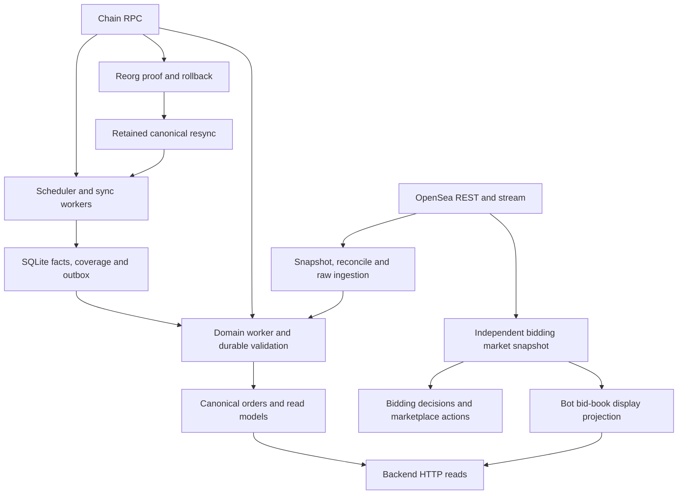

# Deterministic System Testing: Current-State Discovery

This discovery records the starting point for a proposed unified verification
environment. It describes source inspected on 2026-11-07 at base commit
`24cff044`; it does not introduce a testing framework or change runtime behavior.
The [proposed strategy](06-deterministic-system-testing-strategy.md) and
[scenario catalog](07-deterministic-system-testing-scenarios.md) define proposed
work separately. Existing domain references remain the contract owners.

## Architecture and Verification Boundary

ArtGod runs independent local processes over SQLite and NATS JetStream.
External RPC and marketplace services supply inputs. The
[indexer overview](../indexer/00-overview.md) and
[ports and adapters](../indexer/12-ports-and-adapters.md) own the detailed flow.

Arrows summarize data and recovery dependencies, not every transport hop.
Sync acquisition commits facts, coverage and required follow-up intent together;
downstream projections and validation then converge asynchronously. Reorg proof,
rollback and retained resync have separate owners. Canonical history, collection
coverage, validation evidence and broker delivery state are distinct evidence.

Backend reads expose materialized state; the backend does not run ingestion or
the bidding loop. Critically, indexed `orders` are a passive display fallback:
they do not feed bidder placement or competition decisions. Trading maintains
its own OpenSea snapshot and display projection. See
[backend ownership](../backend/README.md) and the
[trading authority model](../trading/03-market-data-and-scaling.md#authority-model).
An indexer scenario cannot establish bidder correctness by checking `orders`.

## Existing Verification Inventory

The following evidence is executable source, not a record of tests run for this
discovery. [Indexer testing](../indexer/11-testing.md) documents the existing
coverage and required inputs in more detail.

| Area                       | Existing evidence                                                                                                                                                                                                        | Boundary and remaining gap                                                                                                                        |
| -------------------------- | ------------------------------------------------------------------------------------------------------------------------------------------------------------------------------------------------------------------------ | ------------------------------------------------------------------------------------------------------------------------------------------------- |
| Chain acquisition and gaps | [Gap batching](../../indexer/tests/sync-gap-batching.test.ts), [gap scheduler](../../indexer/tests/sync-gap-scheduler.test.ts), [ownership](../../indexer/tests/ownership-balances.test.ts)                              | Real pipeline and migrated SQLite with controlled external ports; not a unified order-source journey.                                             |
| Reorg and recovery         | [Rollback](../../indexer/tests/reorg-rollback.test.ts), [recovery](../../indexer/tests/reorg-recovery.test.ts), [broker recovery](../../indexer/integration/reorg-recovery.test.ts)                                      | Proof, stale writes, rollback, resync and delivery failures; order ingestion/validation is not one shared scenario oracle.                        |
| Bootstrap continuity       | [Coverage recovery](../../indexer/integration/bootstrap-coverage-recovery.test.ts), [metadata range refresh](../../indexer/integration/metadata-range-refresh.test.ts)                                                   | Recovery uses production admission, storage and broker adapters; external state remains fixtures.                                                 |
| Order-source ingestion     | [Raw-source persistence](../../indexer/tests/orders-raw-source.test.ts), [offchain dispatch](../../indexer/tests/offchain-dispatch.test.ts), [reconcile](../../indexer/tests/opensea-reconcile.test.ts)                  | Source precedence, normalization and reconcile-run identity; separate from full canonical fork convergence.                                       |
| Validation and lifecycle   | [Demand](../../indexer/tests/order-validation-demand.test.ts), [batch demand](../../indexer/tests/order-validation-demand-batch.test.ts), [maker checkpoints](../../indexer/tests/maker-revalidation-checkpoint.test.ts) | Durable requirements, result/revision fencing, lease recovery and isolated failures; no generated shared-world exploration.                       |
| Queue interactions         | [Order queue healing](../../indexer/integration/order-queue-healing.test.ts), [legacy backlog](../../indexer/integration/order-backlog.test.ts)                                                                          | Held validations, lifecycle work, fairness, death/restart and unresolved demand after queue drain.                                                |
| OpenSea broker recovery    | [Reconciliation integration](../../indexer/integration/opensea-reconciliation.test.ts)                                                                                                                                   | Lease renewal, obsolete backlog and interrupted scans; explicitly does not establish downstream projection convergence.                           |
| User-visible lifecycle     | [Backend lifecycle](../../backend/integration/order-lifecycle.test.ts)                                                                                                                                                   | Real migrations, order transitions, read models and HTTP handlers; seeds already-applied owner/activity facts instead of acquiring chain history. |
| Trading decisions          | [Strategy configuration](../../vitest.bidding-strategy.config.ts), [snapshot service tests](../../trading/src/application/use-cases/bidding/collection-offer-snapshot-service.test.ts)                                   | Separate decision and projection contracts; must remain distinguishable from indexer verification.                                                |

No shared command generator, independent unified reference model, or replayable
cross-subsystem schedule was found in the inspected test facilities. This is a
coverage-organization finding, not proof of a runtime defect or that every
existing test has been inventoried.

## Reusable Harnesses and Seams

| Existing owner                                                                                                                                                                                        | Reusable capability                                                                                                                                                                                                                                    |
| ----------------------------------------------------------------------------------------------------------------------------------------------------------------------------------------------------- | ------------------------------------------------------------------------------------------------------------------------------------------------------------------------------------------------------------------------------------------------------ |
| [Recovery fixture](../../indexer/tests/helpers/reorg-recovery-fixture.ts)                                                                                                                             | `RecoveryRpc` implements the production RPC port with owner/block/log read barriers and exact-hash ownership checks. `reorgRecoveryServices()` composes actual recovery, rollback, sync executor, SQLite and outbox owners; accepts an injected clock. |
| [Chain fixture](../../indexer/tests/helpers/chain-fixture.ts) and [ownership fixture](../../indexer/tests/helpers/ownership-fixture.ts)                                                               | Small repeatable headers, transfer facts and production persistence setup. A forkable world should extend these contracts rather than copy sync logic.                                                                                                 |
| [Isolated NATS](../../indexer/tests/helpers/isolated-nats.ts)                                                                                                                                         | Validates the provisioned broker against runtime policy; starts a private loopback listener and synthetic store; retains logs and supplies bounded readiness/stop helpers.                                                                             |
| [Child bundler](../../scripts/build/build-indexer-test-worker.mjs)                                                                                                                                    | Uses existing esbuild to bundle maintained fixtures, with native SQLite external. Restricts entrypoints to owned test fixtures and output to worktree `tmp/`.                                                                                          |
| [Recovery child](../../indexer/tests/fixtures/reorg-recovery-worker.ts) and [protocol](../../indexer/tests/fixtures/reorg-recovery-protocol.ts)                                                       | Production loops with explicit IPC phases, held reads, publication ambiguity, process death and restart.                                                                                                                                               |
| [Maker child](../../indexer/tests/fixtures/maker-queue-worker.ts)                                                                                                                                     | Production order orchestration and shared admission, controlled RPC barriers/failures, clock replacement and durable restart.                                                                                                                          |
| [Shared offer fixtures](../../shared/testing/opensea-offers.ts), [fill fixtures](../../shared/testing/fills.ts), [event payloads](../../indexer/tests/fixtures/opensea-event-payloads/item_sold.json) | Reusable market records and boundary inputs. Preserve each fixture's synthetic/captured provenance.                                                                                                                                                    |

These seams support an incremental implementation. They do not make the entire
runtime deterministic. Existing real-broker suites retain OS scheduling,
network IO, real timer polling and broker time. Several tests control time with
Vitest fake timers or child-local `Date.now` replacement; other application
paths still read wall time directly, including
[sync fanout](../../indexer/src/application/sync-range-processing.ts),
[offchain dispatch](../../indexer/src/application/offchain/dispatch.ts),
[worker admission](../../indexer/src/application/worker-runner.ts) and
[outbox draining](../../indexer/src/application/queue-outbox/drainer.ts).

Proposed implementation must identify which completion boundaries it controls
and record those choices. A seeded input sequence alone does not reproduce an
uncontrolled async schedule. Production domain transitions and persistence
must remain in the system under test; a simulator that substitutes both would
only verify its own alternate implementation.

## Runner and CI Findings

The [root scripts](../../package.json) chain backend, frontend, indexer and
trading tests. That command does not include the shared workspace's test script
or explicit indexer integration runners. The
[default indexer configuration](../../indexer/vitest.config.ts) includes
`tests/**/*.test.ts`; the broker suites live under `integration/` and have
separate configurations and commands:

| Existing command                                             | Configuration                                                           |
| ------------------------------------------------------------ | ----------------------------------------------------------------------- |
| `yarn workspace @artgod/indexer test:reorg:recovery`         | [Reorg runner](../../indexer/vitest.reorg-recovery.config.ts)           |
| `yarn workspace @artgod/indexer test:orders:queues`          | [Order runner](../../indexer/vitest.order-queue.config.ts)              |
| `yarn workspace @artgod/indexer test:opensea:reconciliation` | [OpenSea runner](../../indexer/vitest.opensea-reconciliation.config.ts) |

The testing guide describes a unit/serialized-DB project split in
[vitest.workspace.ts](../../indexer/vitest.workspace.ts). It uses
`defineWorkspace`, while the pinned Vitest is 4.1.12 and the default config does
not explicitly reference that workspace file. Actual project discovery and DB
serialization must be checked before relying on the documented split. This
discovery did not execute the runner and does not assert a reproduced failure.

The inspected [build workflow](../../.github/workflows/tauri-build-check.yml)
runs documentation and desktop gates. Its indirect
[Linux prerequisites owner](../../scripts/build/verify-linux-release-build.mjs)
runs bidding strategy coverage and desktop/security checks, but not the general
indexer suite or the three broker gates above. No invocation of those gates was
found in the other checked-in workflows. Hosted runs and branch-protection
requirements were not inspected; source configuration alone cannot establish
which checks currently block merging.

Proposed CI work therefore needs explicit service-level gates, independent of
desktop packaging. Existing tests remain valuable alongside a unified suite.
Runner repair, if required, is prerequisite work with its own verification;
adding another command must not conceal skipped or undiscovered tests.

## Isolation, Diagnostics and Evidence Limits

The existing [test environment loader](../../indexer/tests/helpers/test-env.ts)
overwrites process values from `.env.test`, including the database path. Merely
setting a shell variable does not prove isolation. The generic smoke fixture
uses configured RPC plus a container broker; it is separate from offline
deterministic checks and from the provisioned-binary integration runners.

Proposed unified runs should own typed configuration, synthetic state and
private services explicitly. They should fail on missing required tools, use
existing provisioned dependencies, and keep stores and artifacts under the
active worktree's `tmp/`. They must not attach to an operator database, wallet,
configured live broker, or external marketplace by implicit environment fallback.

An empty broker queue is insufficient evidence of convergence: durable order
demand, retained resync, checks, outboxes and continuations may remain. Tests
must inspect the responsible durable owners as well as materialized results.
Likewise, source visibility and protocol fillability are separate contracts;
marketplace absence does not independently prove onchain cancellation.

Proposed artifacts should record scenario/version, seed, selected completions,
fault boundaries, unmet obligations and bounded state diffs with a replay
command. CI should upload an explicit allowlist of synthetic outputs. Reuse the
[redaction owner](../../scripts/build/secret-output-redaction.mjs) for process
output; do not collect arbitrary environment files or operator diagnostics.

No tests, migrations, broker processes, external requests or native runtime
checks were run for this inventory. Existing test source establishes intended
assertions and available seams; it does not establish their current pass rate,
runtime cost, live compatibility or complete interaction coverage. The next
phase must measure those baselines before assigning CI budgets or claiming
determinism, exhaustiveness or production qualification.
