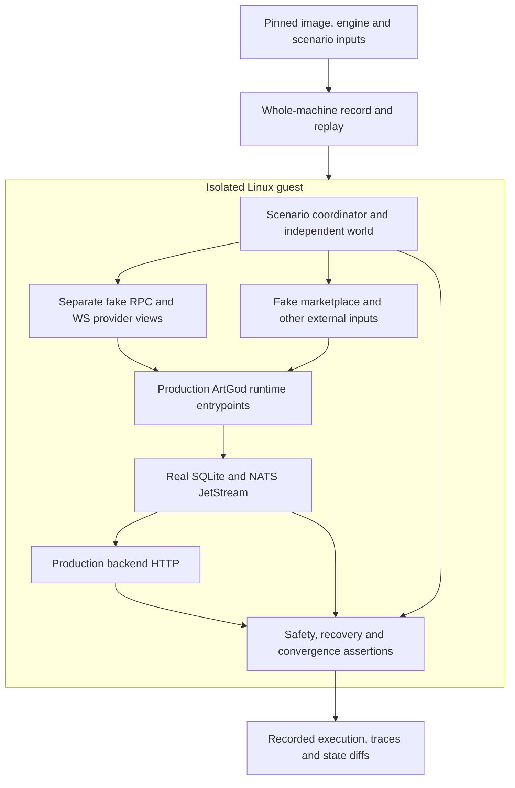

# Production Runtime Simulation Workbench

Design updated 2026-11-08. The user authorized the full workbench direction and
its milestones. The baseline workbench is implemented; local evidence and
unresolved findings are recorded in the execution guide. Implementation alone
is not evidence that every milestone property or scenario family has passed. The initial architecture inventory remains
at source baseline `24cff044` in [discovery](05-deterministic-system-testing-discovery.md).
See the [scenario catalog](07-deterministic-system-testing-scenarios.md) and
[execution guide](08-simulation-workbench-execution.md) for acceptance and commands.

## North Star and Boundary

Build a reusable workbench that runs ArtGod's production headless data plane
inside a controlled machine and deliberately exposes it to inconsistent views,
failures, delayed effects and eventual recovery. Its purpose is to discover and
reproduce failures across the whole system before release, and retain those
histories as continuously executed regressions.

The system under test includes actual production runtime entrypoints,
configuration, weighted RPC selection and retries, scheduler/budget ownership,
sync/reorg/validation loops, OpenSea ingestion/reconciliation, backend HTTP,
real NATS JetStream, real SQLite and their production native dependencies.
Replace external systems only: blockchain RPC/WS providers, marketplace HTTP/WS,
and metadata/media inputs needed by the selected journey.

The previous proposal's application-use-case simulation and separate process
acceptance lanes are superseded as the workbench architecture. Existing unit,
adapter and integration tests remain useful supporting evidence. A test-owned
composition, fake broker/database, direct use-case invocation or seeded final
projection cannot substitute for this system boundary.

The initial product boundary is the production headless data plane. It does not
claim the Tauri GUI, wallet custody, real marketplace transactions, package
execution or native rendered behavior. Those retain their existing tests.

## Execution Substrate and Research Decision

Use a complete Linux guest under QEMU software emulation, containing the real
runtime closure, real broker/database, scenario coordinator and fake external
services. QEMU's documented [record/replay](https://www.qemu.org/docs/master/system/replay.html)
and [instruction-counted execution](https://www.qemu.org/docs/master/devel/replay.html)
cover whole-machine execution, including device input, clocks, interrupts,
network and block operations. A pinned initial image and event log can reproduce
the recorded execution without replacing ArtGod internals.

Two capabilities must remain distinct:

- **Deterministic replay:** reproduce one recorded machine execution from its
  pinned initial inputs. Completion, exact serial parity and equal guest-visible
  disk capacity/bytes qualify a specific run; they do not establish all
  schedules or product correctness.
- **Scenario exploration:** deliberately vary provider visibility, response
  timing, availability, source observations, process failures and legal causal
  schedules. Each resulting execution needs its own assertions and replay
  artifact. A recorded happy path is not an exploration campaign.

The saved tool image reports QEMU `8.2.2`; the input profile selects
`pc-i440fx-8.2`, qboot direct Linux boot and a modern virtio device with
observed Linux DMA bounce buffering. Three earlier M0 pairs and the production
baseline passed locally with exact serial and complete disk parity under the
original CPU and six-check gate. After a later VM-only crypto failure, the
`max` CPU and expanded eight-check gate passed separate local qualification;
the complete 26-case cohort also passed strict replay/disk comparison while
retaining its failed properties. Seven native crashes remain unattributed, so
these passes do not establish correct computation on every exercised path. Legacy host-QEMU
`10.1.5` runs retain their separate provenance. Retained reports distinguish
replay from scenario properties; actual adversarial journeys qualify separately.
The saved tool-container image now pins the emulator's complete userspace as
well as its executables. Legacy host-only manifests retain their original
limits. The host kernel remains external, so portability across hosts must
still be qualified rather than assumed.

Reproducibility alone does not establish correct computation inside an emulator.
The runtime gate must also compare hot arithmetic, native integer conversion and
crypto results against independent known answers. A reproduced runtime failure
must remain distinct from a demonstrated ArtGod business defect. These samples
address observed risks; they are not a proof of every engine or compiler path.

Primary-source comparisons, checked during discovery:

| Approach                                                                                                                                         | Relevant capability                                                             | Decision for this boundary                                                                                                                                                                                                                                                                                                           |
| ------------------------------------------------------------------------------------------------------------------------------------------------ | ------------------------------------------------------------------------------- | ------------------------------------------------------------------------------------------------------------------------------------------------------------------------------------------------------------------------------------------------------------------------------------------------------------------------------------ |
| [QEMU record/replay](https://www.qemu.org/docs/master/system/replay.html)                                                                        | Whole-machine execution and replay with explicit disk/network recording.        | Local baseline. Build authored faults and domain assertions around it; prove guest replay before claiming a working substrate.                                                                                                                                                                                                       |
| [Antithesis](https://antithesis.com/docs/configuration/the_antithesis_environment/)                                                              | Simulated x86-64 machine with hermetic containers and system fault exploration. | Strong later alternative if campaigns outgrow the local engine. [Setup](https://antithesis.com/docs/setup/overview/) requires service access and uploaded images; none is implied by local work. [JavaScript integration](https://antithesis.com/docs/reference/sdk/javascript_sdk/) has vendor-specific availability/configuration. |
| [Hermit](https://github.com/facebookexperimental/hermit)                                                                                         | Controls Linux execution through syscall/thread/input determinization.          | Compatibility trial would need namespace/ptrace/seccomp and possibly PMU support, plus complete Node/Go/native-SQLite workload qualification. It is not an assumed replacement for the QEMU baseline.                                                                                                                                |
| [DetTrace](https://github.com/dettrace/dettrace) / [rr](https://rr-project.org/)                                                                 | Reproducible containers or process record/replay.                               | Useful research/debugging alternatives. Their own supported environments and captured-process boundaries need qualification; no tool was provisioned for this work.                                                                                                                                                                  |
| [FoundationDB](https://www.foundationdb.org/files/fdb-paper.pdf) / [MadSim](https://github.com/madsim-rs/madsim)                                 | Controlled simulation, fault injection and recovery properties.                 | Adopt the testing discipline. Their language runtimes do not execute this existing TypeScript/Go/native closure.                                                                                                                                                                                                                     |
| [fast-check](https://fast-check.dev/docs/advanced/model-based-testing/) / [TLC](https://docs.tlapl.us/using%3Atlc%3Astart)                       | Generate/shrink domain histories or explore a finite specification.             | Possible campaign/specification helpers later. Neither controls the complete production runtime or supplies ArtGod's oracle.                                                                                                                                                                                                         |
| [Anvil](https://foundry-rs.github.io/foundry/anvil/eth/api/struct.EthApi.html) / [Toxiproxy](https://node.testcontainers.org/modules/toxiproxy/) | EVM behavior and network failures.                                              | Supplementary external-system fidelity tools when justified. A local EVM alone does not simulate disagreeing providers, ArtGod process scheduling or durable recovery.                                                                                                                                                               |

These fit judgments are engineering conclusions, not benchmark results. Tools,
images and fixtures must follow existing pinned-input/dependency workflows.

## Architecture

Guest services communicate over real sockets. No host network or filesystem is
mounted into the running guest. Dependencies are prepared before execution;
scenario execution must not reach the public internet or discover an operator
store from ambient configuration.

Run the actual runtime entrypoints and production composition vocabulary.
Keep scenario/control code outside those processes. Observe through external
request traces, production HTTP, logs, broker state and read-only persisted
state. The driver can delay responses, change provider views and stop/restart
guest processes. It cannot decorate a validator, substitute a port result
inside ArtGod, call `completeBatch()` directly, or advance a chain revision in
place of a real detected rollback.

The initial fixture may establish declared collection identity, anchor and
operator inputs at a documented boundary. Every ownership, sale, validation,
rollback and read-model outcome claimed by a scenario must then be produced by
the production path being tested. Where setup bypasses bootstrap orchestration,
the evidence must explicitly exclude bootstrap correctness.

## Provider Views Are First-Class Inputs

Model three distinct kinds of state from M1 onward:

1. **World history:** a graph of branches and immutable state at each block
   hash; the scenario eventually selects which branch survives.
2. **Provider views:** each endpoint's current branch/tip, retained history,
   capability, latency and availability. A provider can be internally coherent
   while disagreeing with another at the same height.
3. **Actual observations:** endpoint, request, block selector, response identity
   and delivery order seen by each production runtime and each retry.

Do not use a single fake RPC that switches all consumers together. Exercise
production routing through multiple endpoints, including a different endpoint
on the next call of one operation. Height and block identity are separate.
Cover header A → numeric state read on B → final header A, alongside simple
A→B changes, lagging heads, WS/HTTP disagreement and unavailable exact hashes.

The oracle knows the scenario's full history; ArtGod only knows observations.
Before the relevant evidence arrives, do not require it to identify the future
winning fork. Check the documented provisional state and retained obligations.
After providers heal, require canonical convergence. Under continued conflict,
specify the safe waiting/refusal state and any permitted independent progress.

`REORG_DEPTH` is the application's configured checking/repair policy. It is
not consensus finality or an agreement guarantee across free RPC providers.
Exercise before/at/after its boundary, and explicitly test out-of-window
disagreement against the recovery/refusal contract that actually exists.

## Properties and Independent Oracle

The [property catalog](07-deterministic-system-testing-scenarios.md#properties)
defines the assertions. Keep three kinds of result distinct:

- **Safety:** no forbidden committed effect, cross-fork proof, lost obligation
  or unrelated deletion at the relevant observation boundary.
- **Recovery/convergence:** after a finite input prefix, restored dependencies
  and fair execution, the expected canonical owner/history/order/read state and
  eligible durable work converge within the declared budget.
- **Safe refusal:** when required evidence stays unavailable or the scenario
  exceeds supported recovery, retain the specified obligation and diagnostics.

Expected answers come from independently scripted world facts, ledger arithmetic
and small reviewed policy truth tables. Do not calculate expected ownership or
ask selection using the production reducer/query being tested. Public constants
and schemas can still be shared.

Preserve current semantics: source status and protocol fillability differ;
upserts/asks currently permit optimistic unvalidated state; rollback does not
globally hide every surviving ask; source completion and broker ACK do not mean
validation completed. Direct OpenSea snapshots drive bidding decisions while
indexed orders are passive display fallback. See the owning
[orders](../indexer/07-domain-orders.md) and
[market authority](../trading/03-market-data-and-scaling.md#authority-model) contracts.

Convergence examines pending demand, unfinished maker work, required outbox
publication, retained canonical checks/recovery/resync, coverage and selected
projections. Mature recent checks explicitly or list them as an expected
endpoint. Queue emptiness, inactivity or a guest exit code alone cannot pass.

## Milestones and Required Evidence

All milestones below are authorized direction. Their state remains unqualified
until actual evidence is recorded; test scaffolding or document text is not a
completed milestone.

| Milestone                           | Work product                                                                                                                                                                                                                                                              | Required evidence                                                                                                                                                                                                                                            |
| ----------------------------------- | ------------------------------------------------------------------------------------------------------------------------------------------------------------------------------------------------------------------------------------------------------------------------- | ------------------------------------------------------------------------------------------------------------------------------------------------------------------------------------------------------------------------------------------------------------ |
| M0: execution qualification         | Build a pinned standalone Linux guest with the real Node/NATS/native-SQLite closure; qualify arithmetic/crypto/native conversions, clocks/entropy, competing writers, reopen, broker persistence and redelivery under whole-machine record/replay.                        | Validated input pins, real guest execution, nonempty replay/serial logs, explicit guest check completion, exact serial parity and equal complete guest-visible disk capacity/bytes. Report host-environment limits. This does not prove sync/order behavior. |
| M1: production system foundation    | Start production headless runtime entrypoints with fake external HTTP/WS. Two tokens, small collection, marketplace input, validation, actual acquisition/fork recovery/resync and backend reads. Include independently coherent provider views and a refused-proof case. | Expected effects produced through production paths; actual endpoint/request trace; safety and post-heal convergence; replay artifacts. Report which stale-result guards and causal cuts were actually reached.                                               |
| M2: deliberate distributed failures | Divergent/lagging providers, per-request failover, A/B/A mixed reads, partial outages, WS/HTTP skew, process death, uncertain publication, restart and competing database writers.                                                                                        | Named fault histories, genuine required refusal/retry behavior, no lost/duplicate business effects, and convergence after healing. Record product failures without silently fixing or accepting them.                                                        |
| M3: authored exploration and CI     | Enumerate bounded legal schedules over domain fault families; maintain an independent coverage ledger and minimized reproductions. Add required short campaigns plus broader scheduled/manual runs.                                                                       | Every declared schedule accounted for; no undiscovered/skipped tests; measured runtime/resource budgets; replay and artifact retention; actual hosted execution before a CI qualification claim.                                                             |
| M4: broaden current system coverage | Cover remaining current actors, maintenance, bootstrap, trading read-authority and extension-trigger interactions using the same workbench.                                                                                                                               | New independent assertions, fixtures and reached-state evidence. Future P2P/multisource/non-EVM behavior needs its own domain contract and is not implemented by this milestone.                                                                             |

The authored startup-maintenance journey checks the backend's passive indexed
bid-book fallback before and after a real source cancellation, and preservation
of the separately declared paused job. It starts no bidder and supplies no bot
authority. This does not qualify bot decision inputs, live bot snapshots or
trading authorization enforcement; those need separate runtime journeys.

No production hardening is implicit in a failed test. Preserve the failing
history, identify the violated or missing contract, and record the finding.
Fixes require their own justified scope, except a concrete blocker preventing
the authorized workbench from running. Never weaken the oracle, disable a retry
or replace a production actor merely to obtain a green run.

## Campaigns, Coverage and Replay

Start with authored histories of realistic disagreement, not undirected random
payloads. Expand each into bounded causal schedules: which provider is visible
when, which response is released first, which actor fails, and when healing
occurs. Larger generation may select these meaningful histories later.

Declare the bounds of every exhaustive claim. Track property → history → reached
checkpoint/guard → assertion → source/image/engine → result. Report unreachable
or precondition-rejected schedules and unsupported cases. Capturing a snapshot
failure does not establish that the later database revision fence was exercised.
The old proposal's post-`finish()` decorator is outside this runtime boundary;
a genuine system execution must reach that race before it earns coverage.

The current four-command planner varies canonical-provider switching (E), source
inventory restoration (R), stream publication (S) and reply-gate release (V).
Its 24 legal orders describe these coordinator commands; selected causal edges
reduce that set. V records releasing the fixture's held reply gate. Actual HTTP
delivery, production validation completion and database writes require their
own observed boundaries. Different command orders can produce the same runtime
interleaving, and command counts alone establish no additional guard coverage.

Retain source and fixture provenance, engine/image pins, external request trace,
fault plan, replay log, guest completion, read-state diffs and unresolved durable
work. A minimized authored scenario and a replayed recording are different
artifacts: replay reconstructs its recorded execution, while retesting changed
code requires recording a new execution of the scenario.

A completed product failure must also be replayed. Record replay success and
property failure independently, keep the overall result failed, and retain the
counterexample. Protocol loss, emulator failure and hangs are different engine
or harness outcomes; they cannot stand in for a reproduced product finding.

A failed scenario can instead expose a fixture, prerequisite or assertion
defect. For example, a stationary synthetic chain that ages beyond the real
validator's freshness policy does not supply fair recovery. Preserve the failed
run and correct the external model; do not assign an application defect from
the failed status alone or change production policy to obtain a pass.

CI partitions the complete named corpus into independent, disjoint jobs;
scheduled/manual exploration adds a job per authored fault model. Each campaign
job owns its six declared causal orders. Failures do not cancel other lanes or
convert missing cases into passes. Choose limits from measured performance
rather than invented seed counts. Hosted runtime remains unqualified until the
workflow actually runs. Existing workspace/integration checks still run
alongside system campaigns; [discovery](05-deterministic-system-testing-discovery.md)
records their current runner/CI gaps.

This remains a growing workbench: unexplained results and unmodeled interactions
are discovery outputs. Add the missing model/fixture/observability deliberately,
retain the failure corpus, and keep the distinction between platform execution,
system correctness and unverified behavior visible in every report.
