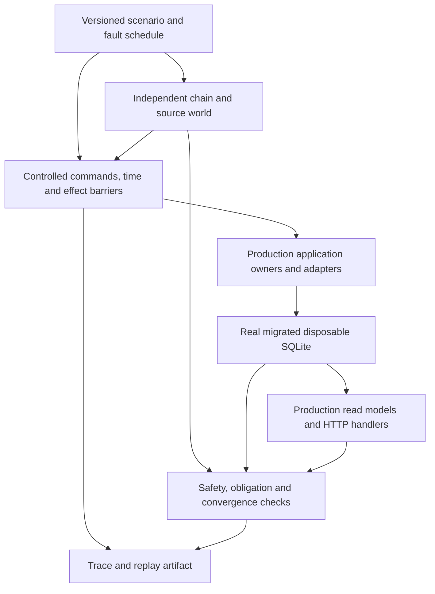

# Deterministic System Testing: Proposed Strategy

Status: discovery proposal, 2026-11-07. No framework, runtime behavior, new CI
gate or dependency has been implemented by this proposal. The source baseline
is `24cff044`. Read the [current-state discovery](05-deterministic-system-testing-discovery.md)
and [scenario catalog](07-deterministic-system-testing-scenarios.md) alongside it.
Current executable contracts remain in the owning domains and source.

## Recommendation and Outcome

Build an ArtGod-owned scenario harness on the existing Vitest, migrated SQLite,
RPC fixtures and maintained worker/NATS helpers. Add `fast-check` for generated
command sequences and shrinking after one vertical scenario proves the harness.
Keep deterministic application execution and real-process acceptance as separate
lanes sharing scenarios and assertions.

The outcome is a repeatable answer to: after marketplace observations, chain
changes, reordered work and recoverable failures, do the persisted facts,
unfinished obligations and user-visible orderbook agree with the declared
contracts? Every failure should identify a violated property, provide a short
event trace, and have a local reproduction path.

This is an engineering recommendation from source inspection and the research
below; candidate tools have not been installed or benchmarked. No surveyed tool
supplies ArtGod's domain oracle or joins its existing owners automatically.

## What the Research Supports

Primary sources were checked on 2026-11-07. Fit judgments are specific to the
current TypeScript/SQLite/NATS architecture. Recheck versions and capabilities
when adopting a dependency.

| Approach                                                                                                                                                | Useful capability                                                                                          | ArtGod fit and decision                                                                                                                                                                                                                                             |
| ------------------------------------------------------------------------------------------------------------------------------------------------------- | ---------------------------------------------------------------------------------------------------------- | ------------------------------------------------------------------------------------------------------------------------------------------------------------------------------------------------------------------------------------------------------------------- |
| [Vitest timers](https://vitest.dev/guide/mocking/timers) plus existing fixtures                                                                         | Control timer advancement in tests.                                                                        | Retain the installed runner. Explicit clocks and effect barriers still need to cover all behavior under test; timers do not control other processes.                                                                                                                |
| [fast-check model commands](https://fast-check.dev/docs/advanced/model-based-testing/)                                                                  | Generate legal operation sequences, shrink failures, replay with seed/path and command replay information. | Preferred local exploration library. Small reference model, domain commands and meaningful assertions remain ArtGod work.                                                                                                                                           |
| [fast-check scheduler](https://fast-check.dev/docs/advanced/race-conditions/)                                                                           | Explore controlled promise completion orders.                                                              | Use around controlled ports. Wrapping a promise delays its result, while its body starts immediately; defer the effect itself when modeling delayed writes or reads. It cannot schedule an unwrapped broker or native database.                                     |
| [Antithesis](https://antithesis.com/docs/introduction/how_antithesis_works/)                                                                            | Vendor-provided deterministic system exploration and replay.                                               | Strong candidate for later deeper process campaigns. Account, service access and a packaged synthetic environment are additional dependencies. Keep baseline CI locally runnable.                                                                                   |
| [Antithesis setup](https://antithesis.com/docs/setup/overview/) and [JavaScript integration](https://antithesis.com/docs/reference/sdk/javascript_sdk/) | Hermetic Linux containers; transpiled Node/TypeScript instrumentation.                                     | Packaging needs fixture RPC/marketplace services. Confirm ESM/PnP, native SQLite, SDK access and commercial/OSS terms in a separate evaluation; public docs ask users to contact the vendor for JavaScript SDK availability. No account or pricing assumption here. |
| [Anvil API](https://foundry-rs.github.io/foundry/anvil/eth/api/struct.EthApi.html)                                                                      | Local EVM execution, snapshots and explicit chain reorganization.                                          | Useful later for real contract/RPC translation and receipts. Does not control ArtGod worker order, marketplace observations or its convergence oracle. Optional adapter lane, no live-mainnet fork requirement.                                                     |
| [Testcontainers/Toxiproxy](https://node.testcontainers.org/modules/toxiproxy/)                                                                          | Service lifecycle and network fault injection.                                                             | Testcontainers already exists for smoke testing. Reuse private NATS helpers first; network chaos is supplementary and not a deterministic scheduler. Avoid adding Docker as a requirement for offline scenarios.                                                    |
| [Jepsen](https://github.com/jepsen-io/jepsen)                                                                                                           | Workloads, fault injection and history checking against running systems.                                   | Borrow the history/checker discipline. Its Clojure/control-node architecture adds substantial machinery for a local desktop system; no direct adoption in the first milestone.                                                                                      |
| [TLC](https://docs.tlapl.us/using%3Atlc%3Astart) / [Stateright](https://github.com/stateright/stateright)                                               | Explore a finite specification/state model.                                                                | Consider a small ownership/fencing protocol when bounded exploration becomes difficult. A separate specification needs an implementation correspondence argument; Stateright's Rust actor model is not the current Node execution model.                            |
| [FoundationDB simulation](https://www.foundationdb.org/files/fdb-paper.pdf) / [MadSim](https://github.com/madsim-rs/madsim)                             | Demonstrate controlled execution, fault injection and recovery properties.                                 | Adopt the method. FoundationDB's Flow runtime and MadSim's Rust runtime are not reusable schedulers for the existing TypeScript application. A runtime rewrite is unjustified.                                                                                      |

The [fast-check license](https://github.com/dubzzz/fast-check/blob/main/packages/packaged/LICENSE)
is MIT. Pin an eligible version through normal Yarn/lockfile and age-gate
procedures during implementation. The proposal does not select a moving latest
version. Test fixture payloads also need recorded origins and redistribution
conditions before being added.

The FoundationDB paper's most relevant lessons are to execute production
behavior under controlled boundaries, check both local invariants and recovery,
measure whether difficult states were reached, and keep external-system tests.
Its simulation limitations are a reason to retain adapter/process qualification.

## Scope and Consistency Contract

First protect the existing EVM indexing/order pipeline: realtime and historical
acquisition, gap repair, canonical checks, rollback/resync, OpenSea observation
and normalization, lifecycle updates, durable validation/maker work, and backend
read models. ArtGod services and state remain local.

The initial acceptance boundary ends at read-only HTTP responses produced by
the real backend use cases/handlers. Browser rendering, wallet custody,
marketplace placement/cancellation, release packaging, extension/media fidelity
and performance qualification keep their existing independent tests. Later
scenario families can reuse the harness when they cross this boundary.

Define three types of claims:

- **Safety:** at each observable committed boundary, no forbidden write or
  loss of obligation has occurred. A failed attempt must leave the state allowed
  by its atomic transaction contract.
- **Convergence:** after a finite input history, restored dependencies and fair
  execution of eligible work, specified projections reach the expected state
  within a scenario step/time budget.
- **Safe refusal:** when ancestry, snapshot proof or required input is
  unavailable, retain the correct obligation and diagnostic state. Deliberately
  blocked work is an expected outcome for that scenario.

Do not demand global instantaneous consistency. A fork can remain locally
unknown until verification; downstream jobs may lag an acquisition commit.
Assert protections relative to captured identities, committed rollback and
admission boundaries, then assert final agreement after convergence. The oracle
must distinguish RPC head, stored headers, collection coverage, ownership
checkpoint, validation snapshot and source observation time.

Current contracts that the oracle must preserve:

- Source activity and protocol fillability are independent. A missing REST
  observation is not proof of an onchain cancellation.
- Upserts optimistically start fillable/active; current asks do not require
  `validated_at`. Testing “never display an unvalidated ask” would introduce a
  new product policy. Assert the documented intermediate state and eventual
  correction instead. See [orders](../indexer/07-domain-orders.md#upsert-flow).
- Source-run completion, broker ACK, acquisition progress, and full validation
  completion are distinct. Retained completion receipts are not pending work.
- Indexed orders are the passive bid-book fallback. Direct OpenSea snapshots
  drive bidding decisions. See [market authority](../trading/03-market-data-and-scaling.md#authority-model).
- Rollback advances the chain revision and removes attributable orphan state;
  it does not globally clear every surviving order's `validated_at` or hide all
  asks. Check refusal of stale result/coverage writes separately from visibility
  of surviving source observations and optimistic order rows.
- A single order row currently has one source identity/status. Multiple-source
  evidence aggregation, P2P propagation and non-EVM finality are future domain
  design, not existing generic capabilities.

Source/collection replacement during a crawl, purge with in-flight work,
bootstrap ownership fencing, and remaining partial-fill quantity require
explicit policy decisions. Characterize and link known limitations; never turn
an incidental current result into a passing correctness oracle. Keep these
decisions outside the initial supported scenario family.

## Harness Architecture and Ownership

Start in `indexer/tests/` with the existing recovery and order-queue fixtures.
Extend/consolidate their owning helpers; do not duplicate recovery composition
or business policy in a new framework. Promote neutral scenario/trace contracts
to `shared/testing/` only when a second package consumes them. Indexer-specific
workers, RPC ports and commands stay in indexer; backend mapping stays backend.

The system under test must execute production normalization, canonical job
admission, sync commit, fork recovery, validation snapshot factory, demand/maker
orchestration and read models. Testing a direct domain call alone can bypass
orphan-envelope rejection; a fake validator can bypass proof correctness.
Extract narrow production composition factories only where reuse is concretely
needed, with runtime and tests consuming the same factory in that change.

Keep these responsibilities small:

1. **World:** a forkable graph of parent-linked blocks; token ownership,
   balances/approvals and protocol state at explicit hashes; independently
   scheduled source observations, pages and cursors. Unknown RPC requests fail
   explicitly. Start with a small supported Seaport/ERC721 fixture vocabulary.
2. **Driver:** issue commands, hold/release external effects and run bounded
   production passes. A logical clock owns wall-time decisions; chain timestamp
   remains a separate input. Stable IDs or recorded injected identifiers control
   UUID/randomness where they affect behavior or replay.
3. **Oracle:** derive expected canonical ownership/history from scripted world
   facts and simple ledger arithmetic, then assert documented order policy with
   small independent truth tables. Read actual stored state and public responses.
   Never use production reducers/eligibility SQL to calculate their own expected
   answer. Consuming public status constants does not duplicate the algorithm.
4. **Trace:** record command, actor, causal origin, effect start/result,
   transaction checkpoint, simulated time and assertion. Persist the actual
   executed schedule, including ignored/blocked commands.

The trusted initial fixture may contain the collection definition, established
anchor, token identity/metadata, anchored ownership snapshot/checkpoint and
operator declarations. It does not prove bootstrap orchestration. Independently
prepare chain/source inputs, then produce all post-anchor owners, sales,
validation and recovery outcomes through the system under test. Do not seed an
outcome row or revision that the scenario is intended to prove.

### Two Execution Lanes

| Lane                             | Real behavior                                                                                                          | Controlled boundary                                                                                | Evidence limit                                                                                                                                                      |
| -------------------------------- | ---------------------------------------------------------------------------------------------------------------------- | -------------------------------------------------------------------------------------------------- | ------------------------------------------------------------------------------------------------------------------------------------------------------------------- |
| Deterministic application system | Production use cases, adapters, migrations, SQLite, normalization/validation and HTTP handlers                         | External port effects, queue delivery, logical time, identity/randomness, explicit pass scheduling | Repeatable declared schedule; synchronous SQLite/native/OS internals are outside explored interleavings. One DB singleton and one active scenario per test process. |
| Process acceptance               | Selected production worker compositions, real private NATS, multiple SQLite connections, restart and competing writers | Fixture RPC/source servers or ports, maintained IPC barriers, recorded fault plan                  | Reproducible input/fault plan and contract outcomes; OS/broker timing is real and exact global replay is not claimed.                                               |

Use existing `IsolatedNats` and child-worker bundling. Add thin wire-fixture
acceptance for real RPC/OpenSea adapters as needed. A later complete runtime
composition test must start the production entrypoints, scheduler, budget owner
and maintenance paths; existing test-owned child compositions do not prove
those entrypoints are wired correctly.

Inventory every behavior-affecting clock, timer, UUID, random choice, I/O and
iteration order in the chosen slice. Use injected `now` where available; prefer
small owner-specific effect/clock seams to pervasive test switches. Do not put a
transaction across an await, reorder effects that production makes atomic, or
change retries/fairness to make a test settle. Broad refactoring waits for
evidence from the first slice.

### Completion and Recovery

After closing finite producers, remove injected faults and permit fair execution.
Inspect all relevant obligations: required unsent outbox rows, admitted/in-flight
deliveries, due/future pending validation demand, unfinished maker scans,
canonical checks, retained recovery/resync, expected collection coverage and
selected projections. Distinguish a deferred retry from a retained receipt.

Recent canonical checks may legitimately await a later head. A convergence
scenario must explicitly advance the fixture head to their maturity, or declare
those exact pending checks as its expected endpoint. Idle/no-progress is never
automatic success. Exceeding a hard step bound reports unmet obligations and
the next eligible time; a real-time watchdog catches harness hangs separately.

Do not require every intermediate state to match a serial final result. Compare
semantic final projections only where histories are equivalent under the
domain's precedence rules; source timestamps, cancellations and replay policy
can make different input histories intentionally different.

## Exploration and Evidence

“Every possible interaction” is unbounded. Use three complementary methods:
named historical/race regressions; exhaustive legal schedules within declared
small bounds; and larger generated command sequences with shrinking. Declare
actors, entities, fork bounds, commands, fault count and scheduling points for
every finite exploration claim. Do not call seed counts exhaustive coverage.

First enumerate legal orders of three prepared completions and a committed
rollback in one small world (at most 24 permutations before causal constraints).
Independently
enumerate the expected schedule list and require every member to complete;
report precondition rejection and unreachable states. Expand to fault-pair and
command-pair coverage, then `fast-check` generation. Preserve causal preconditions
when shrinking a fork/receipt/claim sequence. Store seed, property path, command
replay path where used, and the minimized explicit trace. Pinning seed alone
does not promise replay across code/library changes.

Record per-run scenario/property IDs, visited transitions, reached fault
boundaries, legal schedule counts, executed/blocked commands, command pairs,
state diffs, unresolved obligations, duration and peak memory where practical.
Coverage maps must distinguish specified, implemented, executed and passed;
line coverage is supplementary. Validate the oracle using deliberate test-only
mutations such as accepting stale validation or dropping required publication
intent; each must fail the appropriate property. Avoid carrying production
fault switches for this purpose.

Each bug gets a minimized fixed regression before its fix. If the harness
cannot represent it, extend the owning seam/model and document the fidelity
limit. Keep an explicit list of unmodeled contracts.

## Implementation Sequence and Acceptance

The following milestones are proposed work. Stop after this discovery for scope
review; the first implementation authorization should cover M1 and its named
seams/checks, not an open-ended simulator rewrite.

| Milestone                        | Concrete deliverable                                                                                                                                                                                                                                                                                                        | Acceptance / stopping rule                                                                                                                                                                                                                                                                                                                                                                                                                                                                                                                     |
| -------------------------------- | --------------------------------------------------------------------------------------------------------------------------------------------------------------------------------------------------------------------------------------------------------------------------------------------------------------------------- | ---------------------------------------------------------------------------------------------------------------------------------------------------------------------------------------------------------------------------------------------------------------------------------------------------------------------------------------------------------------------------------------------------------------------------------------------------------------------------------------------------------------------------------------------- |
| M1: prove one joined journey     | Extend the existing fixture to run SC-01 and SC-02 from the catalog: marketplace admission, validation, real fork recovery/resync and HTTP observation, plus one separate SC-12 unavailable-proof refusal. Use one chain, one small ERC721 collection, two tokens, exact-token sell/buy orders and a fork above its anchor. | No seeded outcome rows; M1-relevant clauses of P1–P6 plus one P8 refusal observed at specified boundaries; independent expected answers; both stale-snapshot refusal and post-proof revision-fence rejection reached; all legal orders of three named completions plus rollback; replay artifact; 20 local replays of one selected fixed schedule agree semantically; deliberate stale-result/publication faults are detected. ERC1155 and unrelated-chain clauses remain unexecuted until M2. Surface unsupported contracts before expanding. |
| M2: durable process recovery     | Reuse private NATS/children for SC-03, SC-04 and SC-05; add unaffected collection/chain sentinels, ERC1155 and actual independent SQLite contention.                                                                                                                                                                        | Survive commit-before-ACK, uncertain publication and restart; no duplicate business effects or lost obligation; existing reorg/order/reconcile suites still pass. No claim of exact process scheduling.                                                                                                                                                                                                                                                                                                                                        |
| M3: generated exploration and CI | Adopt pinned fast-check; command generators and shrinking; explicit offline and broker scripts; add a dedicated data-consistency workflow using existing CI security conventions.                                                                                                                                           | Short minimized failures replay; measured runtime/resource budgets; required PR corpus includes M1/M2 and fixed seeds; missing required inputs fail; artifact allowlist; workflow actually executed.                                                                                                                                                                                                                                                                                                                                           |
| M4: broaden intentionally        | Remaining catalog families, production entrypoint acceptance and wire fixtures; optional Anvil/vendor trial with a bounded evaluation.                                                                                                                                                                                      | Extend coverage ledger based on risks and discoveries. Separate adapter, UI, native/release, performance and live-provider evidence.                                                                                                                                                                                                                                                                                                                                                                                                           |

M1 does not require a second orderbook implementation, a new chain abstraction,
containers, a local EVM or an external testing account. Runtime/test seams are
implementation work to review alongside their first scenario.

### Proposed CI and QA Routine

- PR: affected workspace tests **including shared contracts**, fixed named
  offline scenarios and a small fixed generated corpus; selected real-broker
  crash/recovery regressions. Run the explicit existing integration commands
  documented in [discovery](05-deterministic-system-testing-discovery.md).
- Nightly/manual: rotating recorded seeds, longer histories and additional
  fault combinations; retain the failure corpus and promote important failures
  to PR regressions. Scheduled failures need an owner and triage, not silent
  retries until green.
- Before release: production entrypoint acceptance and existing desktop/UI/
  adapter gates. Credentialed live API checks can reveal provider drift but
  remain separate from deterministic required gates.

Set initial pilot budget targets of five minutes for the offline lane and ten
for the selected broker lane on the chosen CI runner. These are design targets,
not measurements. Report p50/p95, replay success and reached-state coverage
before selecting seed/step counts or making checks required. Keep correctness
assertions fixed when adjusting campaign size. Validate runner discovery and
isolation first; a green command that discovers zero intended tests is failure.

Use explicit synthetic configuration and worktree-local `tmp/` stores. Do not
implicitly load `.env.test` or application targets. Required local binaries are
preflighted against the repository pin; no test provisions infrastructure.
CI can prepare its pinned inputs through reviewed repository workflows.

Retain a versioned manifest (source SHA, dependency/fixture versions, seed and
schedule), structured state diff, bounded trace and exact replay command.
Artifact uploads allow only synthetic outputs. Keep raw environment dumps,
credentials, wallets, live payloads and unrestricted databases out; reuse the
existing redaction owner for logs. Preserve local task artifacts under `tmp/`.
No hosted result or branch-protection claim follows from a local run.

## Growth Without Premature Generalization

Carry chain identity, collection identity, protocol identity, order identity
and observation-source identity separately in scenario data. Exercise same
addresses/token IDs across unaffected EVM chains early. Keep fork proof and
finality capabilities explicit rather than assuming every chain has EVM blocks,
Seaport or rollback semantics.

Source fixtures should describe capabilities: complete inventory versus event
hints, ordering/duplication, cancellation authority, cursors and availability.
A future P2P source may have no authoritative absence snapshot. Reuse the
scenario driver and evidence format, then define that source's domain contract
before adding an adapter. Same signed order arriving from two sources needs a
decision about deduplication and independent source evidence; today's single
`source_status` cannot express that automatically.

After M1, review measured seam cost, reproduction fidelity, oracle independence
and actual races reached. Those results decide whether the lightweight approach
is sufficient or whether a tightly scoped Antithesis/formal-model pilot adds
value. This keeps the long-term verification strategy extensible while securing
the current system first.

## Discovery Qualification

The documentation verifier passed for 81 Markdown files; its 15 regression tests
passed, and Prettier 3.8.3 checked all five changed Markdown files. Application
tests, broker/RPC scenarios, runtime benchmarks and hosted CI were not run for
this documentation change. Existing test coverage above is source-inspected;
the proposed scenarios and budget targets have no execution evidence yet.
