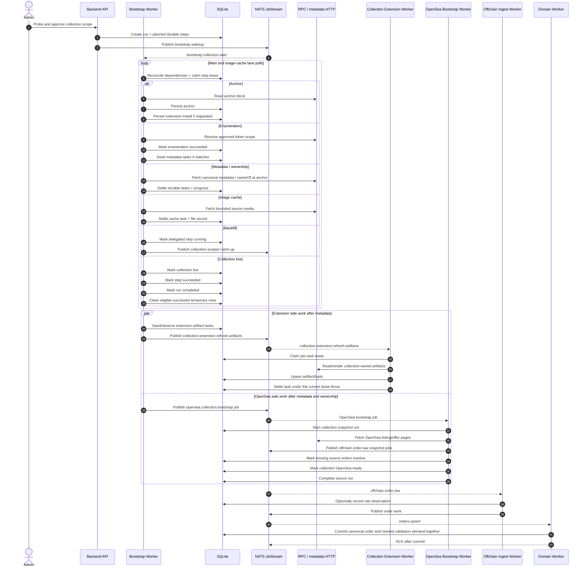
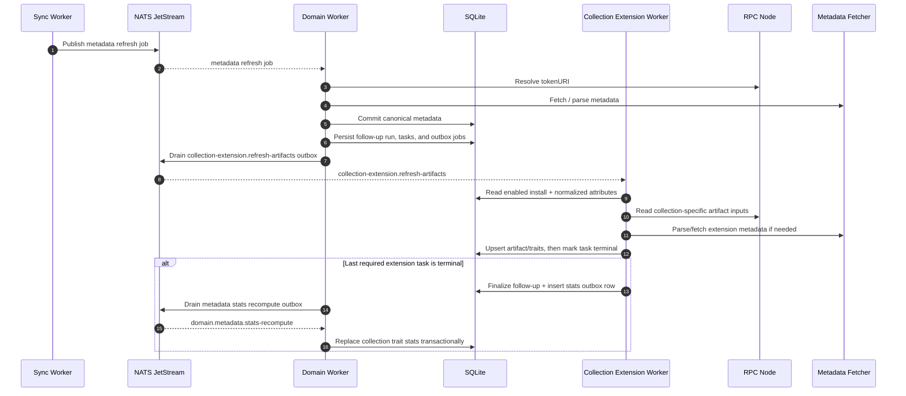
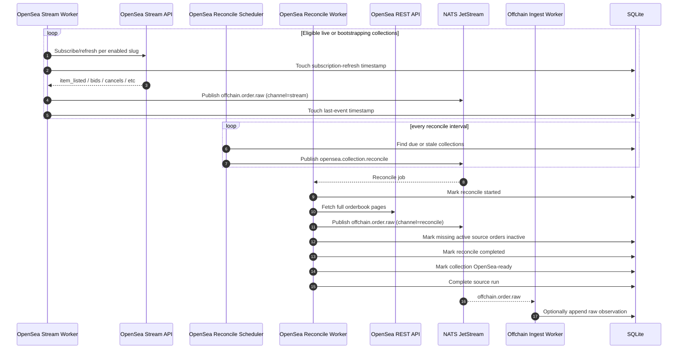

# Sequence Diagrams (High-Level)

These Mermaid diagrams show the current high-level runtime interactions for the indexer and the OpenSea offchain pipeline.

## Realtime Sync + Domain Fanout

```mermaid
sequenceDiagram
    autonumber
    participant RPC as RPC Node (HTTP/WS)
    participant Scheduler as Scheduler Worker
    participant NATS as NATS JetStream
    participant Sync as Sync Worker
    participant DB as SQLite
    participant Domain as Domain Worker

    RPC-->>Scheduler: Head update wakes HTTP sampling
    Scheduler->>DB: Capture local admission watermark
    Scheduler->>RPC: Read head (HTTP)
    Scheduler->>DB: Retain sampled target and admission coverage
    Scheduler->>NATS: Publish realtime wakeup
    NATS-->>Sync: Deliver wakeup
    Sync->>Sync: Wake the serial coordinator
    Sync->>NATS: ACK wakeup
    loop Retained current target has an unapplied prefix
        Sync->>RPC: Fetch next connected logs, headers, transactions and receipts
        Sync->>DB: Atomic facts, ownership, canonical order effects, checks, maker wakeups and applied progress
    end
    Domain->>DB: Read due required follow-ups
    Domain->>NATS: Publish activity/metadata jobs and compact maker continuations
    Domain->>DB: Remove accepted sync intent; retry failed publication
    NATS-->>Domain: Deliver projections and maker continuations
    Domain->>DB: Check event origin hash before admission
    Domain->>DB: Project activities/metadata; expand maker scopes into ordinary demand
```

## Perpetual Collection Gap Repair

```mermaid
sequenceDiagram
    participant Scanner as Sync Worker Gap Discovery
    participant DB as SQLite
    participant Sync as Sync Coordinator
    participant RPC as RPC Node
    participant Domain as Domain Worker Outbox Drainer
    participant NATS as NATS JetStream

    loop Bounded discovery pages, including unchanged heads
        Scanner->>DB: Page live collections and saved scan progress
        Scanner->>DB: Stream bounded descending collection coverage up to HEAD - depth
        alt Missing coverage and no pending repair
            Scanner->>DB: Save cursor and one pending range per collection
        end
    end
    loop Continuous bounded passes; poll only when idle or waiting
        Sync->>DB: Check newest pending height and due HEAD-check times
        Sync->>Sync: Prioritize current applied prefixes and retained recovery
        Sync->>RPC: Read HEAD when a range or HEAD check is due
        opt Collection HEAD check overdue by 30 minutes
            Sync->>DB: Find newest missing blocks above pending range or cursor
            Sync->>DB: Save check time; replace range/cursor only if newer hole found
        end
        Sync->>DB: Select ready members at newest pending height, LIMIT 16
        Sync->>DB: Recheck bounded coverage; trim covered suffixes and reselect priority
        Sync->>RPC: Fetch one common suffix for participating collections
        alt Valid acquisition and retained owners
            Sync->>DB: Atomic data, required follow-ups and exact member progress
        else Acquisition or commit failed
            Sync->>DB: Delay only failed member identities
        end
    end
    Domain->>DB: Read retained follow-up intent
    Domain->>NATS: Publish required jobs with stable IDs
    Domain->>DB: Remove accepted intent or retain retry with capped delay
    Note over Scanner,DB: Completed cycles wait until the next recheck; saved check time includes downtime
    Note over Sync,DB: Historical repair cannot advance accepted current-state prefixes
    Note over Sync,Domain: Failed publication repeats no RPC acquisition
```

## Durable Reorg Recovery

```mermaid
sequenceDiagram
    participant RPC as RPC Node
    participant DB as SQLite
    participant Sync as Sync Coordinator
    participant Domain as Domain Worker Outbox Drainer
    participant NATS as NATS JetStream

    Sync->>DB: Read one eligible pending stored hash and revision
    Sync->>RPC: Fresh header differs from stored hash
    Sync->>DB: Atomically retain mismatch and clear its pending check
    alt Retention fails
        Sync->>DB: Leave check pending with durable retry time
    else Mismatch retained
        Sync->>RPC: Complete bounded common-ancestor proof
        alt Proof unavailable
            Sync->>DB: Retain awaiting_ancestor with delayed retry
        else Verified ancestor
            Sync->>RPC: ownerOf at exact fork hash, requireCanonical
            Sync->>DB: Atomic checkpoints, rollback, revision and resync range
        end
    end
    loop Coordinator passes, independent of HEAD changes
        Sync->>DB: Read due awaiting_ancestor
        Sync->>RPC: Retry bounded proof and exact-hash snapshot
    end
    loop Continuous bounded sync passes
        Sync->>DB: Read one retained canonical range and eligible collections
        Sync->>RPC: Acquire canonical range through shared pipeline
        Sync->>DB: Atomic data, required follow-ups and next range or completion
    end
    Domain->>DB: Read independently retained follow-up intent
    Domain->>NATS: Publish stable revision-qualified jobs
    Domain->>DB: Remove accepted intent or retain required retry
    Note over DB,Sync: Failure before commit leaves acquisition pending; after commit publication needs no RPC
    Note over DB,Domain: Rollback keeps DB-range intent and removes orphan event intent; late orphan hints fail admission
```

## Collection Bootstrap + OpenSea Bootstrap



Validation continues through the local demand loop below; upsert completion
does not publish a second broker envelope or imply validation completion.

## Order Admission and Validation

Source consumers, maker expansion and ordinary validation are separate tasks in
one domain worker. The sync worker alone advances canonical applied state.
Only ordinary validation uses the two FIFO RPC permits. See
[processing ownership](07-domain-orders.md#processing-ownership-and-retained-state)
and [ports](12-ports-and-adapters.md#order-processing-ports).

```mermaid
sequenceDiagram
    autonumber
    participant Source as Source Consumer
    participant Sync as Sync Coordinator
    participant DB as SQLite
    participant Demand as Ordinary Validator
    participant RPC as RPC Node

    Source->>DB: Commit observation, declaration and causal demand
    Note over Source,DB: Sale is an observation; no receipt lookup or terminal assertion
    Source-->>Source: ACK after durable admission
    Sync->>RPC: Sample head after source admission
    Sync->>RPC: Acquire connected required ranges
    Sync->>DB: Commit facts, canonical effects, maker wakeups and applied progress
    Note over Sync,DB: No duplicate canonical by-ID or maker event publication
    loop Poll ready demand
        Demand->>DB: Check causal barrier and shared/collection coverage
        Demand->>Demand: Acquire FIFO capacity
        Demand->>DB: Claim revisions, generations, lease and exact checkpoint
        Demand->>RPC: Full validation at supplied block hash
        Demand->>RPC: Fresh canonicality and snapshot-lifetime verification
        alt Compatible proof and claim remain current
            Demand->>DB: Commit result, independent proof and covered demand
        else RPC uncertainty, dispute or changed claim
            Demand->>DB: Keep unfinished demand retryable; retain dispute if needed
        end
        Demand->>DB: Release unconsumed claims
        Demand->>Demand: Release capacity and yield
    end
```

## Maker Checkpoint and Recovery

A maker step expands a finite candidate page into ordinary demand without RPC.
The checkpoint commits that handoff, cursor and next continuation together.
The outbox's sent receipt is publication evidence, not execution completion.

```mermaid
sequenceDiagram
    autonumber
    participant Sync as Sync Writer
    participant NATS as NATS JetStream
    participant Maker as Maker or Token Handler
    participant DB as SQLite
    participant Outbox as Outbox Publisher
    participant Recovery as Maker Recovery

    opt Canonical maker event
        Sync->>DB: Check indexed candidates and admit relevant scope
        Sync->>DB: Retain one continuation atomically with applied progress
    end
    NATS-->>Maker: Fresh source scope or chain/run/step continuation
    Maker->>Maker: Verify transport identity, owning queue and delivery receipt
    Maker->>DB: Admit or resume retained pass and claim lease
    alt Bounded expansion succeeds
        Maker->>DB: Commit ordinary demand, cursor and continuation
        Maker-->>NATS: ACK
    else Expansion fails after admission
        Maker->>DB: Durably release lease with failure
        Maker-->>NATS: ACK only after recovery owns unfinished work
    else Admission or release remains uncertain
        Maker-->>NATS: Retain delivery for retry
    end
    opt Pass or newer generation still needs a step
        Outbox->>DB: Read committed continuation
        Outbox->>NATS: Publish compact next step
        Outbox->>DB: Record stream/sequence receipt
    end
    loop Periodic bounded recovery and cleanup
        Recovery->>DB: Read unfinished runs and contributing delivery receipts
        Recovery->>NATS: Verify publication and each consumer ACK boundary
        Recovery->>DB: Repair missing wakeups; reap eligible completed receipts
    end
    Note over DB: Completed expansion may coexist with unfinished ordinary demand
```

## Canonical Metadata Refresh + Collection Extension Artifacts



## OpenSea Stream + Reconcile


