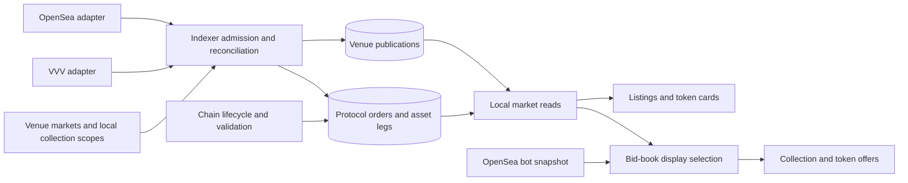

# Multiple orderbooks in ArtGod

**Proposed design for passive market data.** A user browsing a collection or
token should see the best comparable prices across indexed venues, inspect the
other listings and offers, and open the venue that published each one. OpenSea
and VVV are independent orderbooks. An ArtGod collection determines which
assets the user is browsing. Several venues can cover those assets, and a venue
can cover any number of collections.

## Decision

Give the indexer a registry of venue adapters. Each adapter resolves the
markets its venue serves and delivers observations. ArtGod owns the association
with tracked assets, the protocol order, and the local read model. Store the
fact that a venue publishes an order separately from the order's terms and
chain state. One signature published on two venues should produce one economic
quote with two places to find it.

| Approach considered                                          | Consequence                                                                                                                                                            |
| ------------------------------------------------------------ | ---------------------------------------------------------------------------------------------------------------------------------------------------------------------- |
| Query each venue when a page opens                           | A provider timeout affects the page. Grouping, price ranking and pagination depend on independently moving responses. Offline browsing loses its data source.          |
| Keep separate order tables per venue and union them on reads | Ingestion is easy to isolate. Each reader must then resolve duplicate signatures, order validity and price semantics. A fill or rollback has several copies to update. |
| Add a venue column to the existing order row                 | One publication can overwrite another. Making the primary key include the venue preserves both rows but duplicates validation and lifecycle state.                     |
| Shared protocol orders with venue publications               | Adds an identity migration and a join. Each venue can withdraw or go stale independently, while a verified chain event applies once. This is the recommended design.   |

## What needs to move on main

| Current owner                                                                                                                                                                                                                           | Consequence for the change                                                                                                                                                                                                                                                                                                                                                                                                                |
| --------------------------------------------------------------------------------------------------------------------------------------------------------------------------------------------------------------------------------------- | ----------------------------------------------------------------------------------------------------------------------------------------------------------------------------------------------------------------------------------------------------------------------------------------------------------------------------------------------------------------------------------------------------------------------------------------- |
| The collection registry stores one OpenSea slug, readiness, stream gate and reconcile timestamps. The OpenSea slug probe already verifies external identity using a contract and sample token.                                          | Keep that verification inside the OpenSea adapter. Move passive market associations and health to records keyed by venue and market. [Collection schema](../../database/migrations/007_collections_schema.sql) · [Slug probe](../../backend/src/application/use-cases/bootstrap/probe-opensea-collection-slug.ts)                                                                                                                         |
| OpenSea snapshot and stream producers publish to JetStream. The raw envelope requires a local collection ID. Full reconciliation tracks seen IDs and marks missing rows inactive for one source and collection.                         | Extend the existing queue and domain workflow to admit a market-scoped observation once and attribute its assets locally. Keep snapshot traversal and stream decoding in the adapter. [Queue contract](../../indexer/src/domain/offchain-jobs.ts) · [Snapshot producer](../../indexer/src/application/offchain/opensea-orderbook-sync.ts) · [Missing-order reconciliation](../../indexer/src/infra/offchain/sqlite-order-source-state.ts) |
| SQLite keys `orders` by `id`. Its upsert conflicts on that ID, and one row carries the source, source status and local collection. Validation demand references the same ID. Cleanup also consults a collection-wide observation clock. | Introducing a second writer here would lose provenance or make one venue refresh another. Migrate identity, validation, retirement and freshness together. [Order storage](../../indexer/src/infra/domain/orders.ts) · [Validation demand](../../database/migrations/058_order_validation_demand.sql) · [Retention queries](../../indexer/src/infra/storage/sqlite-market-order-queries.ts)                                               |
| Cards, listed sorting and daily seller prices share a current-ask selector. The collection read model returns price and currency. The bidding page can turn that ask into an OpenSea token link.                                        | Carry the winning order and its eligible publications through the same selector. Add a paged all-listings read for users who want the other asks. [Current asks](../../shared/database/current-asks.ts) · [Collection reads](../../shared/read-models/collections.ts) · [Bidding view](../../frontend/src/lib/components/CollectionBiddingView.svelte)                                                                                    |
| The bid-book repository chooses between bot rows and indexed buy orders. The passive SQL requires a scalar price, and both the response and row use the display-feed vocabulary.                                                        | Delegate the indexed branch to the passive market reader. Keep the feed discriminator and give venue provenance its own field. [Bid-book repository](../../backend/src/infra/trading/sqlite-bidding-bid-book-repository.ts) · [Feed types](../../shared/types/trading.ts)                                                                                                                                                                 |

## Resolve venues, markets and assets

1. **Register a venue once.** A bundled adapter owns a stable venue ID, display
   name, supported networks, market lookup, supported observation modes, and
   safe outbound links. Give snapshot, stream and link capabilities separate
   narrow ports. A snapshot-only venue can participate fully in browsing.
   The indexer composition root wires the implementations. Shared market-data
   contracts own identifiers consumed across packages. Collection extensions
   continue to own collection-specific presentation and inventory.
2. **Resolve a remote market.** Start from the selected public network,
   contract and declared token scope. An adapter can verify a provider catalog
   result, an adapter-maintained market entry, or an operator-supplied
   provider locator. Verify the returned network and asset coverage. A slug or
   matching display name alone proves nothing. Return verified, unsupported,
   ambiguous, or temporarily unavailable, with candidate identities where a
   choice is possible. Record unknown coverage when a venue has no discovery
   contract. Persist the verified market, its coverage evidence and the
   operator's enablement separately from sync health.
3. **Associate tracked collections.** A market can feed two local ranges on a
   shared contract, and a local collection can intersect two markets on one
   venue. Store these associations many-to-many. Schedule one fetch per remote
   coverage partition. Route each concrete NFT leg by chain, contract and
   canonical token ID through the existing scope resolver, including token
   zero, ranges and explicit sets. Attribute each unambiguous leg to its local
   scope. On overlap, ask for disambiguation or retain an unresolved
   attribution. Keep untracked counterpart legs in the terms so the local
   asset still has the correct consideration. [CollectionTokenScope](../../shared/collections/token-scope.ts) · [Scope resolver](../../indexer/src/infra/collections/sqlite.ts)
4. **Preserve the scope of broad offers.** A contract-wide wildcard, a
   marketplace collection, a trait and a signed criteria root describe
   different sets. Keep the original criterion. Apply it to a local token
   only with evidence of membership, using the current token-set
   resolution/mismatch rules. Two projects on one contract must never inherit
   each other's collection bids. Resolve again when scope, membership or
   provider coverage changes. A disabled OpenSea integration or a missing
   OpenSea slug still permits a VVV-only collection. [Token-set materialization](07-domain-orders.md#token-set-materialization)

For example, if a single venue market covers token IDs 0–999 and two tracked
collections cover 0–499 and 500–999, fetch it once. An ask on #700 belongs in
the second collection. An offer to give #12 for #700 can link both local token
pages, with the requested and offered roles intact. A quote from a second venue
on #700 appears alongside it without a change to either collection.

## Persistence and authority

These are logical records for the existing order domain. The keys below state
the required uniqueness and lifecycle, leaving physical index selection to
measured SQLite queries.

| Record                   | Identity and contents                                                                                                                                                                                                                                                                                                                                                                                    |
| ------------------------ | -------------------------------------------------------------------------------------------------------------------------------------------------------------------------------------------------------------------------------------------------------------------------------------------------------------------------------------------------------------------------------------------------------- |
| Venue market and binding | Unique market by venue, network and provider-native market reference. A binding joins a local collection to a market with verified coverage, enablement and a revision that fences queued work after edits or purge.                                                                                                                                                                                     |
| Protocol order           | Stable internal order key. For Seaport, unique verified public chain ID, protocol family, verifying contract and order hash. Keep original maker, validity, protocol terms and canonical validation revision. Use the registry to translate local chain references at the boundary. Each future protocol defines its own equivalent identity.                                                            |
| Publication              | Unique remote market and native order reference. Optionally links to one verified protocol order. Holds venue status, reported availability/reason, directed audience, source timestamps and link reference. Conflicting signed terms under one identity go to diagnostics. Rows lacking proof stay source-local and identifiable. Reconcile them onto the verified order atomically when proof arrives. |
| Asset legs and targets   | Internal order key or source-local identity, side of exchange and ordinal, asset type, contract, exact ID or criterion, start/end amount and consideration recipient. Index local collection/token attributions by role. Preserve maker-gives and maker-requests legs. Signed terms own asset movements. Venue-only scope labels and visibility remain attributable to their publication.                |
| Observation and coverage | Market, side/partition, run generation, admitted sightings and watermark. Store last successful transport, coverage result and last applied observation separately. A marketing page, stream and snapshot describing the same order can share a publication. Only the documented scope of an observation can withdraw it.                                                                                |

Merge two publications when their protocol identities and terms agree. Equal
prices, maker addresses, token IDs or bare hashes cannot establish equality.
Two independently signed orders from the same seller remain two inspectable
orders. One verified order uses one validation demand across all its venues.
Use the protocol hash on chain-facing calls and links, and the internal key for
SQL references, cursors and UI row identity.

**A venue controls its publication.** An offchain cancellation on OpenSea
withdraws the OpenSea publication. A VVV availability flag applies to VVV. For
a current quote, require a publication eligible under its venue, audience and
freshness rules, a valid time window and the applicable local protocol checks.
Keep reported availability, unverified protocol state and a local validation
result distinguishable. A negative protocol result suppresses the current
quote across venues. A verified full fill or onchain cancellation closes it
globally. A partial fill requires remaining-quantity evidence before quoting
the remainder. On reorg, invalidate chain-derived proof, revalidate against
the canonical chain and reapply each publication's own visibility.

## Ingestion and reconciliation

- Place remote I/O behind the indexer's venue ports. OpenSea contributes its
  REST and stream adapters. Other venues can supply paged feeds, deltas or one
  bounded snapshot. Normalize once at ingestion. Share protocol decoding,
  validation, prices and local attribution through their owners. Use the
  existing durable queues, domain worker, SQLite transactions and retry
  policy. Admit the publication, its order and attributions, and any new
  validation requirement atomically. ACK after commit. A second venue
  publishing already validated terms can reuse the current proof. The backend
  serves materialized data, including offline.
- Identify work by venue, market, partition, run/event and remote identity.
  Capture receipt time separately from provider event time and source
  revision. Replay is idempotent. A repeated event or late page cannot
  resurrect a withdrawn publication. Allocate a monotonically increasing run
  generation and use a per-partition lease/fence. A stream update newer than
  the crawl boundary wins even if its queue delivery is delayed.
- Admit positive observations in bounded batches. For a complete snapshot,
  record the exact covered partition, visited pages/cursors, seen IDs and a
  terminal receipt. Fence the missing-ID sweep until admitted rows have a
  durable outcome. A queue publish ACK alone establishes neither application
  nor completeness. Persist the sweep cursor and recheck generation and
  observation order in each short write transaction. A crash can resume the
  sweep or supersede it with a later complete generation.
- An adapter may declare complete coverage only under a known enumeration
  contract. Caps, repeated cursors, failed pages, skipped unidentifiable rows
  and unknown coverage permit positive observations only. Only a complete
  generation can deactivate absent publications in the same covered set.
  Overlapping feeds retain their own presence evidence. With partial feeds,
  age each unseen publication using its own last positive sighting and the
  venue's configured freshness horizon. Expose last-known rows as stale and
  exclude them from current-price ranking after that horizon. A healthy
  OpenSea refresh cannot extend a VVV quote.
- Coalesce unchanged terms and validation demand. Fence proofs by order
  revision, chain revision and block. Keep source retirement markers scoped
  to their publication and protocol retirement markers scoped to the order.
  Clean up observations and orphaned orders in bounded passes. Collection
  purge removes its bindings and attributions. Other tracked scopes keep
  their publications and validation state. Delayed jobs cannot recreate a
  purged binding. [Recovery and admission](07-domain-orders.md#processing-ownership-and-retained-state) · [Storage policy](../development/03-sqlite-storage-and-recovery.md)

## Passive reads and navigation

The backend market read port takes chain, tracked collection, optional token,
side, optional venue, eligibility, sort and cursor. It returns typed terms,
order identity, applicable venues and links, and coverage per venue. The
default market selection is **All**. Apply scope, venue, currency,
availability and user filters before grouping, counts, best-price selection
and keyset pagination. Group identical verified orders once, then page the
existing token-card view by token. Use exact integer amounts, the existing
supported native/wrapped ask currencies and deterministic identity ties.
Bind cursors and cache keys to the selected feed, venue, scope and sorting
policy. Reset the visible window if the feed or filter changes.

- **Listings.** On a card show the best eligible simple ask with its venue.
  Token detail lists all asks, including a more expensive one on another venue.
  A cross-posted ask lists both eligible destinations. The shared
  current-ask owner also supplies listed filters, sort, counts and refreshes
  of existing daily seller rows. Only a real listing event creates daily
  history. Discovering the order on a second venue via a snapshot creates
  no historical listing or sale.
- **Offers.** Keep comparable cash offers in the numeric bid-book groups.
  Return structured exchanges in an additional passive section with the
  requested assets, the maker's offered assets, fees and any directed
  audience. Token detail distinguishes offers for this token from orders
  giving this token. Directed or unpriced offers remain discoverable. They
  contribute to a public best bid only when the audience and price basis
  actually qualify. Preserve the existing trait, scope and low-signal
  filtering for comparable offers.
- **Navigation.** From the collection or token, select a venue to see its own
  book and coverage. In local mode, a venue's market list links back to its
  tracked collections with that filter applied. Persist venue selection in
  the URL for deep links and back/forward. Build external links from verified
  adapter link capabilities for the order, token or market. Label the
  destination at its actual granularity. A venue with no external link can
  still be browsed locally. Hosted reads retain the existing public collection
  guard and expose only markets and rows associated with that scope. Source
  labels, outbound links and UI selectors all need the actual venue. Today
  the price cell emits an OpenSea order-hash attribute for every market bid.
  [BidBookPriceCell](../../frontend/src/lib/components/BidBookPriceCell.svelte)
- **Health.** Distinguish a verified empty book, a book with partial coverage,
  a failed refresh with last-known rows, and an unbound market. Expose the
  last successful observation per venue. One failing venue leaves other
  venues' listings, offers and navigation available. Manage bindings,
  retries and stream settings through local Admin.

### Bot snapshot selection

Keep the backend as the single owner of feed selection on both collection
and token bid-book routes. Enabled collection jobs, a fresh running bot
heartbeat and a fresh projected snapshot select `bot_snapshot`. Return the
existing OpenSea bot rows, including a valid empty snapshot. Otherwise
`orders` delegates to the core passive projection. Its numeric rows keep
their existing contract, with venue attribution and a separate typed section
for exchange offers. Listings always use the core ask projection.

Apply venue filters only inside passive market reads. A venue query parameter
cannot force either bid-book route out of bot mode. Suspend the passive
filter/control in bot mode and restore it when the bid book falls back. Keep
direct OpenSea competition, streaming, wallet authorization, placement,
cancellation and snapshot tables inside the existing trading runtime. A
matching maker can identify the user's passive offer. An OpenSea job overlay,
cancellation tombstone or action additionally requires evidence for that
OpenSea order/publication. A VVV-only row confers no trading capability.
[Display selection and authority](../trading/03-market-data-and-scaling.md#bid-book-display-selection) · [Bot snapshot adapter](../../trading/src/adapters/opensea/open-sea-collection-offer-source.ts)

## Migration and review order

1. **Introduce the identities under OpenSea alone.** Add schema, typed venue
   contracts and the core reader. Import the existing OpenSea slug, stream gate
   and sync state. Mark the binding verified where scope evidence exists and
   run the existing probe for an unverified locator. Keep legacy reads
   available until parity. Backfill current rows and protocol keys in
   resumable, bounded transactions using the project's supervised recovery
   path. Retain original protocol hashes and a legacy-ID mapping for
   outstanding work. Preserve unknown provenance as unknown.
2. **Move every lifecycle consumer before enabling a second writer.** Translate
   legacy OpenSea queue envelopes at admission. Move exact-ID updates, maker
   scans, validation demand and receipts, retirement markers, purge,
   reorg handling, daily-price refresh and cleanup to the new identities.
   Recover a legacy onchain hash using its chain and emitting contract where
   available. Revalidate ambiguous candidates individually. Only proven
   protocol-terminal facts may fan out globally. Ship matching runtime
   artifacts and a stopped-runtime SQLite/JetStream restore point for rollback.
   Record the cutover version so a restarted worker resumes with the correct
   writer. Deliver incompatible envelopes on versioned subjects and require
   the matching worker set before producers switch.
3. **Cut over passive reads and controls.** Compare the old and new projections
   on an OpenSea-only database, including optimistic validation state, pending
   jobs, own-order overlays, counts, best asks, expiry and pagination. Derive
   legacy OpenSea status/API fields from the OpenSea binding at cutover. Keep
   OpenSea-specific bidding inputs explicit. Wire typed config, supervisor
   and hosted workers so each venue can be enabled independently; use a
   shared polling scheduler with independent rate budgets and backoff.
4. **Enable the second venue.** Qualify resolution, acquisition, terms,
   completeness and freshness independently for each market. A third test
   adapter on an unrelated contract must plug into the same ports and appear
   through the same UI. Registration plus provider-specific decoding and
   capabilities should be the only venue-specific work.

| Acceptance scenario                                                                  | Observable result                                                                                                                                                                                                  |
| ------------------------------------------------------------------------------------ | ------------------------------------------------------------------------------------------------------------------------------------------------------------------------------------------------------------------ |
| Same verified order on two venues, then OpenSea delists                              | One quote initially lists both venues. The VVV publication remains visible. A verified full fill removes both. A replayed old page cannot reopen either publication.                                               |
| Equal token/price from two different orders, or equal hash on two chains/deployments | Distinct stable identities, rows and cursors. The price and link on each card belong to the same eligible quote.                                                                                                   |
| Two local ranges share one market, then one collection is purged mid-crawl           | One acquisition. Correct token/criteria attribution. Replay cannot repopulate the deleted scope. The surviving range continues to refresh.                                                                         |
| One feed is capped or fails while the other completes                                | Preserve sightings, show per-venue freshness, and retire by absence only inside the completed partition. Expiry and chain cancellation still apply.                                                                |
| Bot starts, snapshot is fresh but empty, then its heartbeat expires                  | The bid book shows the empty bot snapshot and then returns to passive offers. Listings include both eligible venues throughout. No VVV publication generates a bot read, command, cancellation or signing request. |
| Navigation, restart and upgrade                                                      | A shared link reopens the filtered book. An offline restart shows last-known data. An interrupted migration resumes without duplicate economic orders or lost validation work.                                     |

Exercise these cases through the SQLite adapters, durable job redelivery,
HTTP `app.inject()` in local and hosted modes, and the project-owned Playwright
collection/token journeys. Inspect rendered source attribution, structured
offers and empty/degraded states. Measure query plans, memory, queue backlog,
SQLite write rate and validation RPC volume with two populated venues before
turning on automatic refresh.
