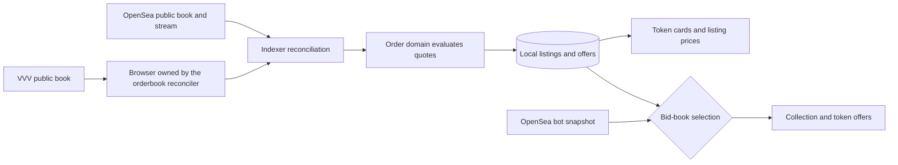

# Multiple orderbooks in ArtGod

**Proposed design.** Collection and token pages show one local book of
currency-priced listings and offers from all matching marketplaces. If VVV
withdraws a 0.8 ETH listing and OpenSea still offers the token for 1 ETH, the
card shows 1 ETH as soon as ArtGod publishes that refresh. The core orderbook
projection ranks offers by what the seller receives after required fees. The
bidding bot and its selected bid-book snapshot use gross OpenSea bids.

At the alpha cutover, ArtGod rebuilds the passive orderbook for the collections
already tracked in the existing database.

## Alpha cutover

Start with empty order and observation tables for the passive book. Clear the
old market run history and refresh positions, order retirement markers, and
pending validation and maker scans for those orders. Reset the market sync
status on each collection while keeping its registration, declared token scope,
venue settings and enablement. Bootstrap each enabled market from its current
book.
[Order storage and retention](07-domain-orders.md#current-state-retention-and-replay)

Pause market producers. Let the raw offchain worker dispatch the activity and
metadata work in mixed messages it already received. Stop the old order workers
and retire their pending jobs on the broker and in the SQLite queue outbox by
subject and job kind before starting the new book. Shared queues and outbox rows
for other domains keep their progress.
[Offchain dispatch](../../indexer/src/application/offchain/dispatch.ts) ·
[Queue outbox](05-storage-and-schema.md#metadata-refresh-follow-ups-and-queue-outbox)

The same database keeps chain history and fills, NFT metadata and ownership,
permanent activity (including daily listing prices), settings, and the bot’s
jobs, own orders and cancellations. A daily listing records the historical price
even after its order leaves the live book. The bot’s OpenSea snapshot has its
own writer. These storage boundaries allow a market-only reset.
[Storage ownership](../development/03-sqlite-storage-and-recovery.md) ·
[Daily listings](09-domain-activities.md#permanent-daily-listings)

## Build on the OpenSea path

OpenSea bootstrap and periodic reconciliation already share a reader. It records
the IDs returned across listings and offers, compares them with active local
orders after the last page, and protects newer stream observations. Today it
applies missing orders in batches visible to readers and refreshes a seller’s
existing daily price inside each batch. Keep the reader, set comparison and
orders domain. Change the point at which a completed book becomes visible.
[OpenSea reader](../../indexer/src/application/offchain/opensea-orderbook-sync.ts)
·
[SQLite comparison](../../indexer/src/infra/offchain/sqlite-order-source-state.ts)

Each venue adapter finds markets, declares what its feeds cover, and translates
their records. The indexer gathers that evidence. The order domain evaluates it,
applies settlement facts and publishes the combined projection in SQLite. The
backend serves the local projection, including offline. The frontend reads
the existing collection and token routes. [Worker ownership](00-overview.md) ·
[Order processing](07-domain-orders.md)

## Run two shared orderbook workers

Rename `opensea-reconcile-scheduler-worker` to
`orderbook-reconcile-scheduler-worker` and `opensea-reconcile-worker` to
`orderbook-reconcile-worker`. Start both with the rest of the indexer in
desktop, development and Compose. The scheduler queues due markets. The
reconciler runs the selected venue adapter for initial reads, refreshes and
retries. The VVV adapter opens its anonymous browser inside the reconciler
when there is a VVV book to read. OpenSea’s stream worker starts its
subscriptions only when its own integration is enabled. Both sources feed the
existing order domain.
[Current scheduler](../../indexer/src/runtime/opensea-reconcile-scheduler-worker.ts) ·
[Current reconciler](../../indexer/src/runtime/opensea-reconcile-worker.ts) ·
[VVV browser reader](22-vvv-orderbook-adapter.md#fetch-the-book-from-a-browser-in-a-local-worker)

**What happens at startup.** With the default OpenSea settings, an empty API
key and no active VVV market binding, the two workers reach ready and wait.
They issue zero marketplace requests and launch zero browsers. Read OpenSea’s
mode and key when the composition starts. Adding a key takes effect on the
next composition restart. OpenSea’s explicit `disabled` mode and its
configuration error for explicitly requiring OpenSea without a key still apply.
An already associated VVV market can be read with OpenSea off. If its last
association is removed, stop its refreshes and release the unused browser.
The shared workers stay up.
[OpenSea configuration](../../shared/config/opensea-integration.ts)

**Dedicated follow-up.** Automatically discovering or activating a market
when a user newly tracks or bootstraps a collection, including VVV for 111K,
is separate work. This includes any changes to the 111K embedded extension.

**Move the existing responsibilities with the names.** The desktop supervisor
currently skips these processes when OpenSea is off, and both entrypoints load
a config that requires its key. Remove the OpenSea launch gate from the shared
pair and load provider configuration only for eligible adapters. Move the
existing OpenSea first-read handler into the reconciler, including its
identity, snapshot and ready steps, their retry and terminal outcomes, and the
action that starts sync for an already live collection. Preserve the bootstrap
run that requested each result. Once both publishers use the shared reader,
retire the old OpenSea snapshot worker. The collection bootstrap worker keeps
its metadata and ownership responsibilities.
[Desktop launch rules](../../src-tauri/src/runtime/supervisor.rs) ·
[OpenSea bootstrap worker](../../indexer/src/runtime/opensea-bootstrap-worker.ts) ·
[Start sync for a live collection](../../backend/src/application/use-cases/collections/start-opensea-collection-sync.ts)

Carry the rename through the shared queue contracts, publishers, consumers,
runtime builds, launchers, Compose, settings, logs and metrics. Preserve the
reconciler’s delivery lease during a long read. Use bounded, independent
consumers in the same process so a VVV timeout or retry leaves OpenSea able to
refresh. Serialize overlapping reads of the same feed and check its binding
again when consuming a job. The sync worker already hosts multiple queue
consumers in one process. If a supported installation cannot run the VVV
browser in this reconciler or keep OpenSea progressing during a VVV failure,
record the failing case and block VVV enablement there. A separate service
would require a new design decision.
[Worker composition](../../indexer/src/runtime/sync-worker.ts) ·
[Delivery lease](../../indexer/src/config/opensea-reconcile-worker.ts) ·
[Runtime registry and verification](../desktop/02-runtime-registry-maintenance.md)

## Map a market to tracked assets

- Register each venue once in the indexer composition root. To resolve a market
  for an existing tracked scope, use the venue’s catalog entry or a configured
  market reference. The adapter verifies the public chain and NFT contract.
  OpenSea can use its existing slug probe. VVV starts with the verified market
  entry in its adapter. A display name or ArtGod collection slug alone cannot
  identify a remote book. Persist the verified association (the binding) and
  its revision independently of the outcome of a refresh.
  [OpenSea slug probe](../../backend/src/application/use-cases/bootstrap/probe-opensea-collection-slug.ts)
  ·
  [VVV market evidence](22-vvv-orderbook-adapter.md#find-and-read-a-vvv-market)
- Allow several markets to cover one local collection and one market to cover
  several local collections. Schedule each distinct public book once. Route each
  exact token by chain, contract and token ID through
  `resolveTokenScopedCollectionId`. It understands token zero, ranges and
  explicit lists. If one market covers IDs 0–999 and the local collections split
  at 500, an ask for #700 belongs to the second collection. An ambiguous or
  untracked token can be reconsidered after the local scope changes.
  [Collection scope](../../shared/collections/token-scope.ts) ·
  [SQLite scope resolver](../../indexer/src/infra/collections/sqlite.ts)
- Keep the signed target and the venue’s description of a collection or trait
  offer. Use the existing token-set membership and mismatch handling before
  attributing it to a local collection or token. A wildcard for a whole
  contract, a venue collection on part of that contract and a signed criteria
  root each cover different assets. Removing a binding or purging one collection
  drops its local association and rejects delayed work for that association.
  Another collection using that market keeps its association. Match current
  publications against the scopes of all active bindings. Stop polling when
  the last enabled association is removed.
  [Token-set materialization](07-domain-orders.md#token-set-materialization)
- For each enabled, bound market, the first read and periodic reads use the
  same reconciler. The scheduler uses the last successful market run to decide
  when another read is due. Bootstrap requests for an existing OpenSea market
  retain their collection progress even when several requests share a read.
  OpenSea owns its API key, slug and stream toggle.
  [Bootstrap planner](../../backend/src/application/use-cases/bootstrap/bootstrap-pipeline-planner.ts)
  ·
  [Reconcile scheduler](../../indexer/src/runtime/opensea-reconcile-scheduler-worker.ts)

## Identify the feed, placement, signed order and quote

- **Feed.** Record who supplied the evidence, its chain, market, view or
  partition, and its run or event position. Two feeds can report the same
  listing. Keep the observation time and the feed’s authority with each report.
- **Venue placement.** Identify the publication by publishing venue, chain,
  remote market and venue-native order ID. Store its presence, venue status,
  reported fillability, audience and revision. A feed relaying a VVV listing can
  corroborate that placement. It creates a separate placement only if there is
  evidence another venue actually published the order there.
- **Protocol order.** For Seaport, verify the signed components against the
  public chain ID, verifying contract and order hash. Namespace that identity by
  protocol. One verified order owns its maker, signed criteria, validity,
  settlement state and remaining quantity. It has one validation demand across
  all placements. Keep an identifiable record with incomplete signing evidence
  attached to its feed and placement until it can be verified. Matching maker,
  token, price or a bare hash is insufficient to merge orders.
  [Seaport verification](../../indexer/src/application/offchain/seaport-protocol.ts)
  ·
  [Validation ownership](07-domain-orders.md#processing-ownership-and-retained-state)
- **Quote and route.** A route identifies where and on what terms a buyer or
  seller can use a placement. Bind the price to its settlement order, placement,
  currency, fill quantity, fees, audience and verified destination. A route may
  narrow the signed criteria or the quantity it offers. Relaying the order
  cannot add units or broaden its token criteria. Several eligible routes can
  offer the same units. Count that order and its available quantity once.

A VVV withdrawal ends the VVV placement’s contribution. A relay that later
repeats the old listing cannot revive it. An independent OpenSea placement for
the same signed order can still supply a quote. An offchain cancellation applies
to its exact placement. Confirmed protocol cancellation or full fill closes the
order across all placements. For a partial fill, every route draws from the same
proven remaining quantity. On a chain reorganization, revalidate the affected
settlement facts and keep independent venue evidence.
[Order lifecycle](07-domain-orders.md) · [Reorg handling](06-reorg-handling.md)

## Apply each book change

The adapter declares what a successful read can establish before the indexer
uses a missing ID as evidence.

- **Complete snapshot.** Replace the membership of the declared book. OpenSea
  completes its public listings and offers traversal after the final page
  succeeds. VVV’s public `orders` array is the returned book for its verified
  market. Compare every successful VVV read with its predecessor, even if it is
  shorter, the same size with different IDs, or empty. An empty array removes
  every prior member of that returned book. Whether VVV also hosts orders
  outside this view does not delay those removals.
- **Bounded window.** Identify the window by its actual boundary, such as a
  fixed top-N query for one side of a market. Replace membership within that
  view. An order leaving the window loses the contribution that came from it. A
  separate current observation can still support the order elsewhere. A page of
  an unfinished snapshot cannot replace a window or a book.
- **Sequenced feed.** Persist the last consecutive event position. Ignore
  duplicates. If a position is missing, hold later events for replay within the
  feed’s recovery limits. Freeze the feed’s accepted position and freshness
  until replay fills the gap, or establish a new snapshot with a known position
  and resume from there. For sources without a sequence, use the ordering the
  adapter can substantiate. In particular, preserve OpenSea’s guard for stream
  observations newer than an overlapping REST crawl.
- **Search or individual sighting.** Add or update the identified records. A
  subsequent search can return different matches without withdrawing the earlier
  placements. A wallet-specific view has its own scope. When feeds overlap,
  apply explicit withdrawals from the publishing venue to that placement and
  keep independently supported placements eligible.

For each accepted replacement record every **addition, change and removal** by
scoped native ID and run. Compare membership even for an order that is
unfillable or still queued. Compare the normalized fields that affect the quote,
including status, `fillable`, fees and audience. A change to `fillable = false`
withdraws that placement’s quote while its ID stays present. If the ID later
disappears, record a separate removal. In the two saved VVV books, all 44
surviving listings whose `fillable` flag changed had identical source
`updatedAt` values across the two reads. An identical repeated observation
advances last-seen time without duplicating a change. A withdrawn order that
later reappears gets a new addition, subject to any terminal settlement
evidence.
[VVV capture comparison](23-orderbook-discovery.md#two-saved-vvv-books)

A timeout, HTTP challenge, missing `orders` array, wrong market, unreadable
identity or failed page leaves the last accepted book in place. If VVV last
showed a 0.8 ETH ask at noon and later reads fail, the card still shows **0.8
ETH · last seen at noon**, even if OpenSea has since confirmed 1 ETH. Missed
refreshes alone do not remove or demote the quote. A later successful VVV book
without the order withdraws it immediately. Expiry, fill, cancellation or a loss
of fillability can also remove it.

Keep the last successful observation time separate from failed attempts. A
search dates only the records it returned, and a snapshot dates its declared
membership. Losing a feed or going offline leaves that time intact. A known ID
with invalid signed terms can be recorded as present and ineligible. Apply the
existing order retention rules to orders with unknown expiry.
[Order retention](07-domain-orders.md#current-state-retention-and-replay)

## Publish one complete refresh

A generation is one accepted version of a feed’s book. SQLite readers must see
either the preceding generation or its complete replacement. This matters for
permanent history as well as for the current price.

1. Read one replacement at a time per feed scope. Stage IDs, normalized terms
   and changes privately in bounded SQLite batches, tagged with the run number
   and remote market definition. Compare against accepted feed membership,
   including IDs whose order upsert is pending. Carry source event time and
   local receipt time separately. Preserve each distinct change even when
   another placement keeps the aggregate price the same.
2. Prepare the final eligible routes and the affected collection prices against
   this candidate generation **and all other active feeds**. Reuse current order
   validation where available. A new order awaiting required evidence can be
   present while validation is pending. Its eventual result is a separate
   change. Compare the candidate against newer stream events at publication,
   including orders first seen on the OpenSea stream. A stream sighting can
   supersede an older snapshot difference for the current quote while the
   difference remains recorded.
3. Derive today’s price **once per affected seller, token and collection** from
   the final eligible set. If this seller has another comparable ask, update the
   existing daily activity row to the lowest surviving buyer cost for the same
   quantity, using the same ETH/WETH comparison as the card. Store the actual
   payment currency. Otherwise keep the row’s last published price and currency.
   The token becomes unlisted when no seller has an eligible ask left. A
   withdrawal creates no activity row. The audit exercised the current
   daily-price writer with 0.8 and 1 ETH asks removed in different batch orders.
   Both ended unlisted, but permanent history could retain either amount. Under
   this design, if both disappear in one refresh and the previous daily price
   was 0.8 ETH, it stays 0.8 ETH. If only the cheaper ask disappears, the
   published price becomes 1 ETH.
   [Daily-price writer](../../indexer/src/infra/storage/sqlite-daily-listing-prices.ts)
   · [Listing history contract](09-domain-activities.md)
4. Publish in **one SQLite transaction**. Check that the preceding generation,
   relevant feed and binding revisions, chain evidence and price validity
   windows still match the staged calculation, including its UTC day. If
   anything moved, abandon the commit and recompute the affected results before
   retrying. Otherwise switch the active generation, publish its per-order
   changes, apply the prepared daily-price writes, advance affected collection
   revisions and release required follow-up work through the outbox. Mark the
   refresh successful at that commit. A failed daily-price write rolls the whole
   publication back. Staging can span batches and a restart. Neither users nor
   history see an intermediate batch.
   [SQLite write policy](../development/02-sqlite-write-contention.md) ·
   [Transactional outbox](05-storage-and-schema.md#metadata-refresh-follow-ups-and-queue-outbox)
5. Resume or discard unpublished work using its run ID and market definition.
   Retry after commit by recognizing the already published generation. Key
   queued work by feed, placement and observation revision. Recheck the current
   placement at the order writer so a delayed upsert cannot resurrect a removal.
   A missing order drops out in the publication transaction even if the queue is
   backed up. Keep the applied change and removal revision for the existing
   retention and replay window.
   [Dispatch](../../indexer/src/application/offchain/dispatch.ts) ·
   [Order queue recovery](18-order-queue-recovery.md)

## Read one combined book

Start VVV with fixed-price, single-unit cash listings and offers. NFT-for-NFT
and NFT-plus-currency trades are deferred.

Rank listings by the total the buyer must pay on an eligible route. Rank
indexed offers by what the seller receives after all required fees. Keep the
bidder’s full amount, required fees and seller’s proceeds in exact currency units.
Calculate each route’s cost and proceeds in its settlement currency. Compare
offers for the same fill quantity and currency, with a stable order and route
tie-break. For each verified order, choose the eligible route with the lowest
buyer cost or the highest seller proceeds for the requested quantity before
ranking orders. Keep its price, fees and destination together when selecting or
linking the winner. If fees, eligibility or remaining quantity cannot be
established, retain the observation without advertising an executable price.

For the single asking price on the grid, compare native ETH and the chain’s
supported WETH at **1:1** for the same NFT quantity, after including required
fees. A 1 ETH listing and a 0.95 WETH listing produce **0.95 WETH** on the card.
Keep the winning listing’s payment currency and link. The shared ask selector
uses the same comparison for listed sorting, the floor and each seller’s daily
price. Other currencies keep their own comparison groups. VVV displayed one
listing as 0.13 ETH. Its signed payments add up to **0.130585 ETH**, the price
ArtGod shows the buyer.
[Current asks](../../shared/database/current-asks.ts) ·
[Captured listing terms](22-vvv-orderbook-adapter.md#read-the-signed-terms)

### Which offer appears first

Suppose two bids are eligible for the same NFT. Buyer A offers **1.00 WETH**. The
order pays **0.05 WETH** to fee recipients, leaving **0.95 WETH** for the
seller. Buyer B offers **0.98 WETH** with no fees, so the seller receives the
full **0.98 WETH**.

1. **Rank by what the buyer offers before fees (gross).** Compare 1.00 WETH
   from A with 0.98 WETH from B. A ranks first at **1.00 WETH**. A seller
   accepting A receives **0.95 WETH**. The bidding bot uses this rule to
   determine which OpenSea bid to beat. If both bids are on OpenSea, its
   snapshot shows A first.
2. **Rank by what the seller receives after fees (net).** Compare 0.95 WETH
   from A with 0.98 WETH from B. B ranks first at **0.98 WETH** and pays the
   seller **0.03 WETH more**. The core projection selects B and publishes
   **0.98 WETH** as the best offer for every indexed reader. Collection and
   token pages read that result. If B withdraws, the core selects A and
   publishes **0.95 WETH**.

On either venue, ArtGod checks that buyer A has **1.00 WETH** and has authorized
the protocol to spend that much. The buyer must fund both the seller’s payment
and the fee.
[Captured VVV bid and fees](22-vvv-orderbook-adapter.md#read-the-signed-terms) ·
[OpenSea bot bid calculation](../../shared/trading/open-sea-bidding-offers.ts)

### Which bids appear on a token

Apply the same passive bid-book rule to both venues. On OpenSea the read
selects active, fillable buy orders within their
validity window and matches the token ID or applicable criteria. ArtGod admits
orders optimistically and validates them asynchronously. For a WETH bid it
checks the order hash, signature when supplied, protocol status, maker counter,
and the bidder’s WETH balance and spending allowance. Users can see an eligible
bid on a token page without connecting a wallet or approving an NFT transfer.
[Order admission](07-domain-orders.md#upsert-flow) ·
[Seaport validator](../../indexer/src/application/offchain/seaport-validate.ts)
·
[Token bid-book read](../../backend/src/application/use-cases/trading/get-token-bidding-bid-book.ts)

All 122 captured VVV cash bids were full, open Seaport orders with a zero zone.
Each signed for one exact NFT to be delivered to the bidder. VVV’s
`counterparty` address sits outside those signed terms. A different address from
the current owner gives no basis for hiding the bid or discounting its price. An
otherwise eligible offer for #42 appears normally on #42 and competes for its
best offer. Apply VVV’s own `fillable` flag to its placement, and honor actual
signed or verified venue restrictions for either marketplace. Token and
restricted bids stay within their real scope. Trait or criteria bids need proven
token membership to contribute to that token’s price.
[VVV offer terms](22-vvv-orderbook-adapter.md#read-the-signed-terms) ·
[Seaport order types](https://docs.opensea.io/docs/seaport-enums) ·
[Bid-book selection](../../backend/src/infra/trading/sqlite-bidding-bid-book-repository.ts)

### Rows, counts and floor

The collection view, token cards and listed sorting
use the same price selection. Read rows, order and token counts, and the floor
from one SQLite snapshot at one collection revision and evaluation time.
Deduplicate settlement orders and choose their eligible routes **before**
grouping and paging. Page groups in stable order in SQLite, then fetch route
details for the returned orders. Index both settlement-order lookups and feed
membership. A continuation cursor identifies its view version and sort position.
Restart the page sequence when that version or a time-based eligibility boundary
changes. [Current asks](../../shared/database/current-asks.ts) ·
[Collection reads](../../shared/read-models/collections.ts)

### Refresh and navigation

Preserve the existing public single-collection scope
and private-context rules. Check the collection revision on each cache hit and
prevent an older refresh from overwriting a newer result. Recheck prices at
order start and expiry. Refresh the winning feed’s last-seen label on failure or
recovery, even when its orders and prices stay the same. Changes to attribution,
audience, validation and ownership can invalidate a result even when the amount
stays the same. Link a displayed price to its eligible route when the
destination is verified, otherwise use local token detail. Users browse all
eligible indexed marketplaces together on the existing pages. Attribution is
available for later hints on a focused token card.
[Collection detail cache](../../backend/src/application/use-cases/collections/cached-get-collection-detail.ts)
·
[Public read scope](../backend/02-http-security-and-deployment-modes.md#public-single-collection-mode)

### Bot snapshot selection

Both bid-book routes select the OpenSea bot snapshot when the collection has an
enabled bidding job, its running heartbeat is fresh and the snapshot is fresh. A
fresh empty snapshot displays zero offers. On fallback the user sees the
combined indexed offers. Listings always read the local projection. Identify the
selected feed and its price basis. Bid placement, repricing and competition
indicators use the bot’s OpenSea competition data. A higher seller-facing offer
on VVV changes the indexed book only. A matching maker can identify an own
offer. An own-order action, pending cancellation or completed cancellation
applies only to the exact placement the job controls. A VVV placement for the
same maker or signed order remains independent.
[Display selection and trading authority](../trading/03-market-data-and-scaling.md#bid-book-display-selection)

## Acceptance before enabling additional feeds

- Start the composition without an OpenSea key or an active VVV binding. Check
  that the shared pair is ready, makes no marketplace requests and launches no
  browser. Repeat with OpenSea alone, with an existing VVV binding alone, and
  with both. For OpenSea, set the key and restart the composition. With both
  venues active, interrupt a VVV read and verify OpenSea can still complete a
  refresh. Check the existing OpenSea initial-sync and retry paths. Run
  `yarn check:runtime-registry` after the rename.
- Exercise the VVV browser reader early in the packaged shared reconciler.
  Start with a bound VVV market and collection and token pages closed. Run the
  initial read and several scheduled refreshes. Restart the reconciler and
  verify it opens a new browser session when the next read is due.
  Interrupt a read and check that ArtGod keeps the previous book and its last
  successful read time. Restore access and check the next successful refresh
  applies every addition, change and removal.
  [Browser acceptance](22-vvv-orderbook-adapter.md#adapter-acceptance)
- Start with a populated database and outstanding order and metadata jobs. Reset
  only the passive book and its work. Verify an old order delivery cannot
  recreate a quote, unrelated jobs still complete, and chain history, daily
  listings and bot state survive. Bootstrap the existing tracked collections.
  Test two unrelated collections, two local ranges on one contract, one shared
  market fetched once, a scope change or purge during a read, and a VVV-only
  collection with OpenSea disabled.
- Replay smaller, equal-sized and empty VVV books, unchanged timestamps with
  changed availability, a failed read followed by a valid empty read, removal
  then reappearance, and a delayed upsert. Exercise a bounded window, search
  omissions, overlapping feeds and a sequenced gap through replay or a fresh
  baseline. While VVV is unreachable, assert its 0.8 ETH ask keeps its last
  successful timestamp and still beats 1 ETH. Then return a valid empty VVV book
  and assert the card switches to 1 ETH.
- Interrupt staging, fail the publication transaction, then restart before and
  after its commit. Read concurrently during a multi-batch replacement. Check
  rows, counts, floor and existing daily history against one version, including
  both orderings of the two-ask removal. Repeat while another venue or the chain
  changes an affected quote.
- Exercise a relayed order, two independent placements, two otherwise identical
  orders with different salts, and identical hashes on different deployments.
  Check total quantity after a partial fill, cancellation and reorg.
- Check that the captured VVV listing costs the buyer 0.130585 ETH and the
  captured VVV offer pays the seller 0.0905905 WETH. In the two-buyer example,
  verify the core projection selects B at 0.98 WETH and switches to A at
  0.95 WETH when B withdraws. Check the same results through the collection
  and token reads. With both bids on OpenSea, the bot ranks A at 1.00 WETH.
  Check that the 0.95 WETH ask wins over 1 ETH with the correct currency and
  link.
- An otherwise eligible open bid must rank the same for #42 on either venue
  even if VVV names a different counterparty. Exercise a genuine restriction,
  an unresolved criterion and an underfunded bidder. Check the bot’s fresh,
  empty and fallback views with an own cancellation on one placement.
- On a deep book, add many duplicate publications and check that pages have the
  same groups, counts and floor with no repeated or skipped group. Inspect query
  plans and measure peak memory to verify a page read does not materialize the
  whole book. The saved responses and existing OpenSea tests cover the
  comparison and price inputs. The multi-feed reads and the packaged browser
  worker need these checks during implementation.
  [Discovery and verification notes](23-orderbook-discovery.md#checks-completed-on-25-november)
