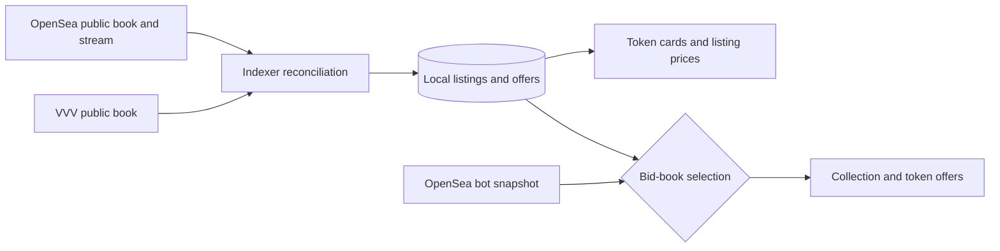

# Multiple orderbooks in ArtGod

**Proposed design.** Collection and token pages show one local book of
currency-priced listings and offers from every matching marketplace. If a token
is listed for 1 ETH on OpenSea and 0.8 ETH on VVV, its card shows 0.8 ETH. When
that listing disappears from VVV, ArtGod records its removal and the card shows
1 ETH. If VVV publishes it again and it is still fillable, the card returns to
0.8 ETH. The user stays on the same page throughout.

Marketplace identity belongs to each quote. That lets a later update explain
price differences on a focused token card. Collection and token browsing always
use the combined projection when showing indexed orders. The bidding bot has its
own OpenSea feed. NFT-for-NFT and NFT-plus-currency trades are deferred.

## Build on the OpenSea path

OpenSea bootstrap and periodic reconciliation already use the same reader. It
walks both sides of the book, records the order IDs it saw, and sends orders
through the offchain queue. After the last page succeeds, SQLite compares the
seen IDs with active local orders for that source. For each eligible missing
order it changes the source status, advances the order revision and refreshes
the affected seller’s existing daily price in the same transaction. A newer
stream observation can take precedence over a crawl that started earlier.
[OpenSea reader](../../indexer/src/application/offchain/opensea-orderbook-sync.ts)
·
[SQLite comparison](../../indexer/src/infra/offchain/sqlite-order-source-state.ts)
· [Order processing](07-domain-orders.md)

Extend that reader’s observation and reconciliation contract to accept a market
from any registered venue. The venue adapter finds the market, reads its pages
or stream, recognizes its IDs, and decodes the venue’s fields. The existing
indexer owns comparison, order admission, validation, projection and recovery
for every venue. The backend and frontend continue to read locally. Two
independent projectors would have to agree on fills, duplicates, price, and what
to do when one venue withdraws an order. Fetching venues when a page opens would
also make the same token show different prices depending on which request
finished. One local projection resolves both problems.
[Worker and queue ownership](00-overview.md) ·
[Ports and adapters](12-ports-and-adapters.md)

## Map a market to tracked assets

- Register each venue once in the indexer composition root. When a collection is
  added or its scope changes, ask each enabled adapter for markets covering its
  chain and contract. Use the venue’s catalog or a verified configured
  reference. If the venue is temporarily unavailable, retry its lookup
  independently. Its adapter verifies each match against the public chain and
  NFT contract it serves. OpenSea can use its existing slug probe. VVV can start
  with the verified market entry in its adapter. A display name or ArtGod
  collection slug alone cannot identify a remote book. Record a verified binding
  and its revision independently of the outcome of the last refresh.
  [OpenSea slug probe](../../backend/src/application/use-cases/bootstrap/probe-opensea-collection-slug.ts)
  ·
  [VVV market evidence](22-vvv-orderbook-adapter.md#find-and-read-a-vvv-market)
- Allow several markets to cover one local collection and one market to cover
  several local collections. Schedule each distinct public book once. Route each
  exact token by chain, contract and token ID through
  `resolveTokenScopedCollectionId`. It understands token zero, ranges and
  explicit lists. If one market covers IDs 0–999 and the local collections split
  at 500, an ask for #700 belongs to the second collection. An ambiguous or
  untracked token can be reconsidered after the local scope changes.
  [Collection scope](../../shared/collections/token-scope.ts) ·
  [SQLite scope resolver](../../indexer/src/infra/collections/sqlite.ts)
- Keep the signed target and the venue’s description of a collection or trait
  offer. Use the existing token-set membership and mismatch handling before
  attributing it to a local collection or token. A wildcard for a whole
  contract, a venue collection on part of that contract and a signed criteria
  root each cover different assets. Removing a binding or purging one collection
  drops its local association and rejects delayed work for that association.
  Another collection using that market keeps its association. When a new local
  scope joins an already indexed market, match the current publications to it as
  part of setup. Stop polling when the last enabled association is removed.
  [Token-set materialization](07-domain-orders.md#token-set-materialization)
- Have the bootstrap planner schedule the first read for each verified market.
  The periodic scheduler then uses each market’s last successful run to decide
  when it is due. Today both paths select OpenSea by collection slug. Generalize
  that selection and the worker configuration so a VVV-only collection can sync
  with OpenSea disabled and without a collection extension. OpenSea still owns
  its API key, slug and stream toggle.
  [Bootstrap planner](../../backend/src/application/use-cases/bootstrap/bootstrap-pipeline-planner.ts)
  ·
  [Reconcile scheduler](../../indexer/src/runtime/opensea-reconcile-scheduler-worker.ts)

## Identify the order and each place that publishes it

Today `orders.id` is the primary key. The upsert writes a single source, local
collection and source status. If two venues submit the same hash, one can
overwrite the other’s evidence. Giving each venue a copy of the whole order
would make chain validation, fills and rollbacks apply twice. Preserve these
facts separately in the existing order domain.
[Orders schema](../../database/migrations/003_orders_schema.sql) ·
[Order writer](../../indexer/src/infra/domain/orders.ts) ·
[Validation demand](../../database/migrations/058_order_validation_demand.sql)

| Fact                     | Identity and owner                                                                                                                                                                                                                                                                                                       |
| ------------------------ | ------------------------------------------------------------------------------------------------------------------------------------------------------------------------------------------------------------------------------------------------------------------------------------------------------------------------ |
| What was signed          | One internal order ID. For Seaport, identify it by public chain ID, protocol family, verifying contract and verified order hash. It owns maker, target, currency, quantity, validity and settlement state. One order has one validation demand.                                                                          |
| Where the order was seen | A publication identified by venue, chain, remote market and native order ID. It refers to the signed order once verified. It owns presence, reported availability, any venue-specific audience, and its last applied revision. The same signed order can have several publications.                                      |
| Which book was read      | A run belongs to the public market and the side or partition the adapter actually read. Store its order in that series, outcome and last successful read. A wallet’s private view or another market is a different series.                                                                                               |
| What changed             | Record each added, changed or removed publication under its run and native ID, including the previous and new source state or their revisions. Replaying an accepted run produces the same changes once. Keep change records and removal revisions through the existing queue recovery and market-data retention window. |

Different salts can identify two genuine orders for the same seller, token and
price. Two valid signatures for the same order can identify one quote.
Conflicting terms under a native ID need a diagnostic and cannot overwrite a
verified order. Use the original protocol hash and verifying contract on
chain-facing calls. Existing validation decides balances, approvals, counters,
fills and cancellations. A confirmed protocol cancellation or full fill applies
to every publication of that order. For a partial fill, a quote for the
remaining units needs evidence of the quantity still available. On rollback,
invalidate the affected chain evidence and revalidate against the canonical
chain. An explicit OpenSea offchain cancellation keeps the OpenSea publication
closed under its existing rules. An ordinary disappearance is reversible and
affects only that publication.
[Seaport verification](../../indexer/src/application/offchain/seaport-protocol.ts)
· [Reorg handling](06-reorg-handling.md)

Keep a legacy order with incomplete protocol evidence under its source's own
identity. Preserve OpenSea’s current admission and optimistic fillability rules.
Only merge two publications once their protocol identities agree. If stronger
evidence arrives later, link the publications and their existing references in
one transaction so the user never sees a duplicate. A second publication for an
already validated order can reuse the existing validation result while it is
current.
[Order admission and validation](07-domain-orders.md#processing-ownership-and-retained-state)

## Apply each book change

Compare IDs from successive successful reads of the same book. For VVV the
public `orders` array is that book. For OpenSea the read finishes after its
listings and offers traversal succeeds. Compare membership even for supported
orders still awaiting validation or currently reported unfillable.

| Previous read | Next read                | Change to record and apply                                                                                                                                                                                                           |
| ------------- | ------------------------ | ------------------------------------------------------------------------------------------------------------------------------------------------------------------------------------------------------------------------------------ |
| Absent        | Present                  | Add the publication, normalize its terms and admit it for the existing order checks. An order that disappeared and returned gets a new addition. Existing explicit cancellation or full-fill evidence still governs its eligibility. |
| Present       | Present, different state | Record an update. For example, changing `fillable` to false removes that venue’s quote from the current price while keeping the publication present.                                                                                 |
| Present       | Missing                  | Record a removal for that native ID and withdraw its contribution immediately. The next eligible price takes its place. If another venue publishes the same eligible order, keep the quote once with its remaining source.           |
| Present       | Present, same state      | Record a successful observation. The quote and its change history stay the same.                                                                                                                                                     |

A shorter book, two equally sized books with different IDs, and a valid empty
book all follow these rules. Empty removes every previous member of that scope.
A timeout, an HTTP challenge, a missing array, an unreadable order identity, a
wrong market or a failed page supplies no comparison set. Keep the previous
accepted membership and retry. An identified row with invalid price or signature
still has a known ID. Record its presence and the validation failure, and
exclude that publication from eligible quotes. A skipped barter row contributes
no cash order. Regular expiry, chain updates and independent markets continue
while a fetch is failing.

### Ordering, retries and restart

1. Run one read at a time per public book. Give each read an increasing run
   number and the version of the **remote market definition** it read. Stage the
   IDs and required terms in bounded SQLite batches as the pages arrive. An
   interrupted read can be discarded. A change to the remote definition
   invalidates work for that version. A change to one **local collection
   binding** only requires checking that collection’s attribution again.
2. After the read succeeds, use the existing SQLite set comparison against the
   last accepted source membership. Include IDs still awaiting an order upsert
   or validation. Prepare the per-order changes in bounded batches under the run
   ID. One commit marks the set ready to apply. A crash before that commit
   leaves the previous book intact. A crash afterwards leaves the changes to
   finish. Finish this run before applying the next read of the same book.
3. Apply the changes in the existing source-state completion step. For each
   batch, one transaction records the transitions, writes publication status,
   refreshes affected existing daily seller prices and advances the affected
   collections’ market revisions. Persist the progress cursor in that write. The
   next local read sees the updated quotes. If writing a seller price fails, the
   corresponding removal rolls back and is retried. The last batch marks the
   refresh complete. A removal takes effect even with an order upsert queue
   backlog. It never waits for a second miss or for expiry.
4. For changes that need normalization or order admission, use the existing
   SQLite queue outbox to commit the follow-up with the publication. Its
   publisher delivers the work to the existing order pipeline. Include venue,
   market, native order ID and run or stream event in the job identity. Check
   the current publication revision at the write. Yesterday’s queued upsert
   cannot recreate a withdrawn quote. A restart or a lost acknowledgement cannot
   repeat a transition. Admission still commits the signed order and any
   validation demand together under the existing domain contract.
   [Offchain dispatch](../../indexer/src/application/offchain/dispatch.ts) ·
   [Transactional queue outbox](05-storage-and-schema.md#metadata-refresh-follow-ups-and-queue-outbox)
   · [Queue recovery](18-order-queue-recovery.md)
5. Keep OpenSea’s existing treatment of stream orders. Include active orders
   first seen on the stream in the missing-ID sweep. Recheck at each write for
   stream evidence newer than the start of the crawl, allowing for the way
   unchanged stream timestamps are grouped today. Retain the difference between
   the two returned books even if a newer stream event determines the current
   quote. Compare event time and local receipt separately. For two VVV reads
   seconds apart the later set wins immediately.
   [Source-state comparison](../../indexer/src/infra/offchain/sqlite-order-source-state.ts)
   · [Current completion semantics](00-overview.md#eventual-consistency-notes)

A successful identical read advances that book’s observation time. Existing
expiry and periodic revalidation rules still apply to its present orders. One
market’s success cannot refresh a missing publication or another market that
failed. Record each market’s last successful read, any failure and the counts
added, changed and removed on its run. Compact applied changes under the
existing retention policy only after outstanding work can no longer reverse
their result.

## Read one combined book

- **Listings.** Extend the shared current-ask selector once. An eligible order
  needs a present publication that offers it to this audience, supported
  currency and scope, and the order domain’s existing time and fillability
  checks. Keep price, currency and quantity together. Compare exact integer
  prices per unit within the existing supported currencies. Keep the existing
  stable tie-break for equal prices and retain the winning order and eligible
  sources. Cards, listed sorting and collection counts use that price. On
  removal, refresh today's existing seller activity row to the next ask. If the
  last ask disappears, the next read shows the token as unlisted. The historical
  activity row keeps the seller’s last observed price, as it does today. A
  refresh never creates a listing activity for a disappearance.
  [Current asks](../../shared/database/current-asks.ts) ·
  [Daily seller prices](../../indexer/src/infra/storage/sqlite-daily-listing-prices.ts)
  · [Collection reads](../../shared/read-models/collections.ts)
- **Offers.** The indexed branch of the existing bid-book repository reads the
  same eligible orders, deduplicates by verified order before counting and
  paging, and keeps the established currency, token, trait and collection scope
  rules. Place an eligible public cash offer in its target token’s book and
  collection even when the viewer has no wallet connected. A token-specific or
  directed offer must not set a floor bid available to every holder. Use known
  target and ownership evidence for prices advertised as available to a seller.
  A venue’s intended recipient and a restriction enforced by the signed order
  are different facts.
  [Bid-book repository](../../backend/src/infra/trading/sqlite-bidding-bid-book-repository.ts)
  · [VVV offer terms](22-vvv-orderbook-adapter.md#read-the-signed-terms)
- **Refresh and navigation.** Use the current collection and token routes,
  including their public single-collection scope and private-context rules. Keep
  the API’s display source (bot or indexed) separate from the marketplaces
  publishing a quote. The passive feed label must describe the combined book.
  Read each price-bearing response and the local collection market revision from
  the same SQLite snapshot. Check the revision on a cache hit and refuse to
  install an older background refresh over a newer result. Use the revision in
  the frontend’s refresh signal. This catches a removal even when the latest
  surviving order timestamp stays the same or the result becomes empty.
  Validation, ownership and chain changes that affect a quote advance the same
  revision. Bound a cached result by the next relevant order start or expiry
  time so a price cannot outlive its signed window. A non-winning publication
  can also disappear while the best price holds. Retain that change and its
  attribution. Apply the same link rule on collection cards, token cards and
  sale previews. A price link must identify a verified destination for its
  source, or use the local token detail. Future hints on a focused card can use
  the saved attribution.
  [Collection detail cache](../../backend/src/application/use-cases/collections/cached-get-collection-detail.ts)
  ·
  [Bidding view](../../frontend/src/lib/components/CollectionBiddingView.svelte)
  · [Price cell](../../frontend/src/lib/components/BidBookPriceCell.svelte)

In SQLite, test whether at least one eligible publication exists for an order
before counting, sorting or paging. Index that lookup by order and active
publication, and the reconciliation comparison by market and native ID. Fetch
the winning price’s sources after selecting the order. Verify the query plans
with books the size of the captures. This avoids sorting a second copy of each
order every time another marketplace publishes it.

### Bot snapshot selection

The existing collection and token bid-book routes select the bot snapshot when
the collection has an enabled bidding job, the running heartbeat is fresh and
the snapshot is fresh. A valid empty bot snapshot displays zero offers. When the
selector falls back to indexed orders, the user sees the combined offers.
Listings always use the local projection. The bot’s inputs, bids, cancellations
and snapshot writer continue to use OpenSea. A maker address can mark an own
offer from either venue. Attach an OpenSea job, cancellation or action only when
its OpenSea identity matches.
[Display selection and trading authority](../trading/03-market-data-and-scaling.md#bid-book-display-selection)

## Migration and acceptance

1. Introduce the identities, binding and run records with OpenSea as the sole
   writer. Import its known slug, stream gate and sync state. Reuse its probe
   where coverage needs verification. Backfill legacy orders, known provenance,
   validation demand and retirement markers in resumable batches. Preserve an ID
   mapping for queued work and existing reads. Keep unknown provenance explicit.
   Use the existing supervised migration and recovery facilities.
   [Market-data lifecycle](../../database/migrations/055_market_data_storage_lifecycle.sql)
   · [Order queue recovery](18-order-queue-recovery.md)
2. Move snapshot and stream ingestion, source-status updates, purge, cleanup,
   validation, onchain fills and reorgs to their respective keys. Match chain
   events by deployment and hash, retain local bootstrap anchor checks, and keep
   an inactive publication’s replay marker separate from a protocol-terminal
   marker. Translate older queue envelopes at admission. Coordinate
   producer/consumer versions before enabling the second writer. Verify stopping
   and resuming with pending work and a restore using matching database, queues
   and binaries. Compare old and new readers on an OpenSea-only database,
   including prices, counts, sorting, criteria, daily rows and the bot selector.
3. Enable the VVV adapter through the same scheduler and order worker. Replay
   smaller, equal-sized and empty books, a failed read followed by a successful
   empty one, a changed availability flag, duplicate delivery and withdrawal
   followed by reappearance. Delay the first upsert until after the second read.
   Interrupt a comparison and an apply batch. In each case assert individual
   changes, final membership, projection, and daily price. Test a newer OpenSea
   stream sighting during a crawl and two VVV reads a second apart.
4. Verify with two unrelated collections, two ranges on one contract, and one
   market bound to both ranges. Exercise one venue alone, both publishing one
   signed order, identical hashes on different chains or deployments,
   independently signed orders on one token, a last-publication removal and a
   shared onchain cancellation and reorg. Check source attribution, exact
   fee-inclusive prices, directed offers, a warm cached page becoming empty, and
   a trade contributing zero bids. Exercise both bid-book routes through
   indexed, fresh bot, empty bot and back to indexed, with an OpenSea
   cancellation overlay present.
   [Capture evidence and existing test coverage](23-orderbook-discovery.md)
